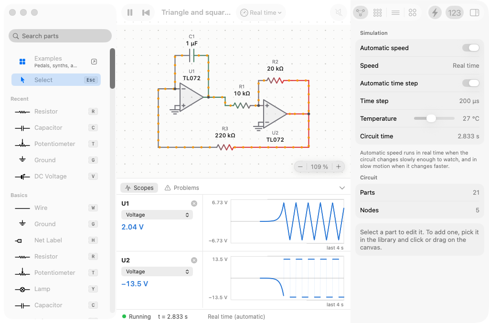
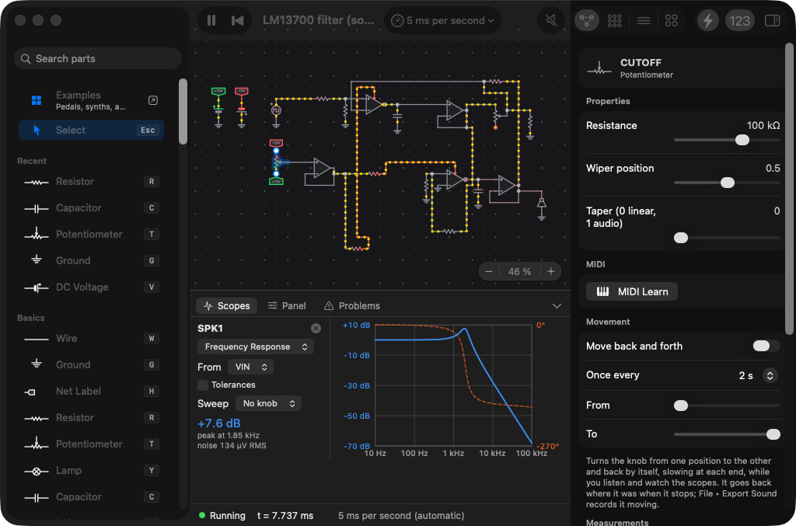

# JSpice

This repository is a fork of [JSpice by Knowm](https://github.com/knowm/jspice), a Java circuit simulator, and is now home to **JSpice for Mac**: a native macOS circuit simulator in the spirit of iCircuit and the Falstad applet. Draw a circuit and watch it run live, with voltages shown as colour and current as moving dots; hear it through a speaker part, measure it with scopes and frequency responses, run Arduino and Eurorack firmware on its microcontrollers, and lay it out on a breadboard. Its engine is checked against ngspice. The Mac app is written in Swift and uses none of the Java code.

**[Read about JSpice for Mac](macos/README.md)**: how to install it, draw a first circuit, and everything it does.

| | |
| --- | --- |
| [macos/](macos/README.md) | JSpice for Mac: the app, its engine, the MCP server for AI agents, and their documentation in [macos/docs](macos/docs/guide.md) |
| [CONTRIBUTING.md](CONTRIBUTING.md) | how the Mac app is built, tested and checked in CI |
| `src/`, `pom.xml` | the original JSpice in Java |
| [documentation/JAVA.md](documentation/JAVA.md) | the original JSpice's documentation |
| [LICENSE](LICENSE) | the license |

## The original JSpice (Java)

JSpice is a SPICE-inspired analog circuit simulator made in Java with an emphasis on simulating memristors and analog circuits containing memristors: DC operating point, DC sweep and transient analysis of SPICE or YAML netlists, built with Maven (`mvn clean package`). Its documentation, from how modified nodal analysis works to running a netlist, is in [documentation/JAVA.md](documentation/JAVA.md).

