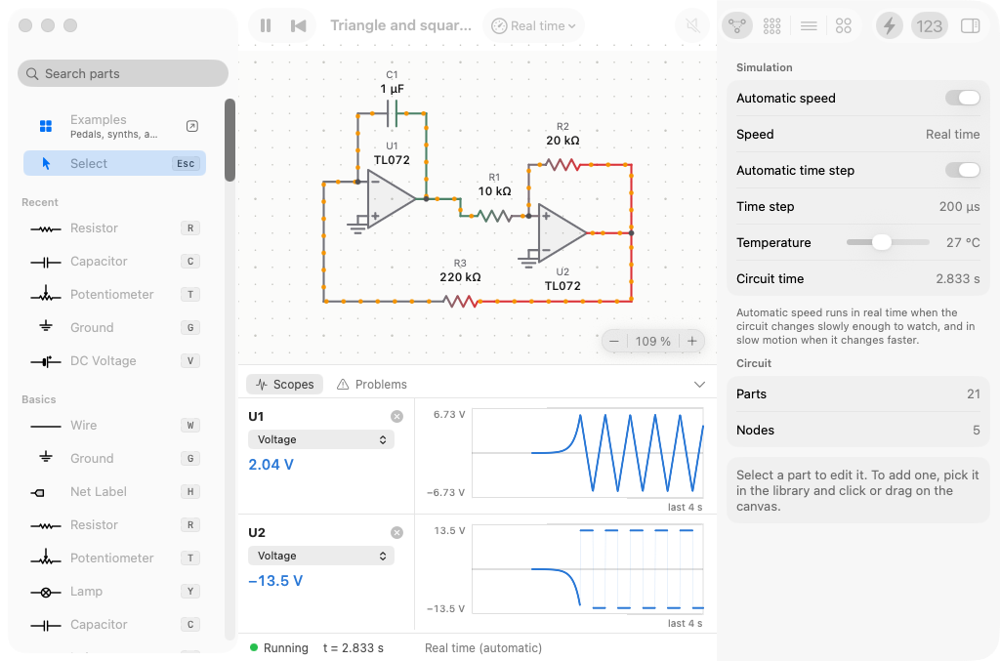
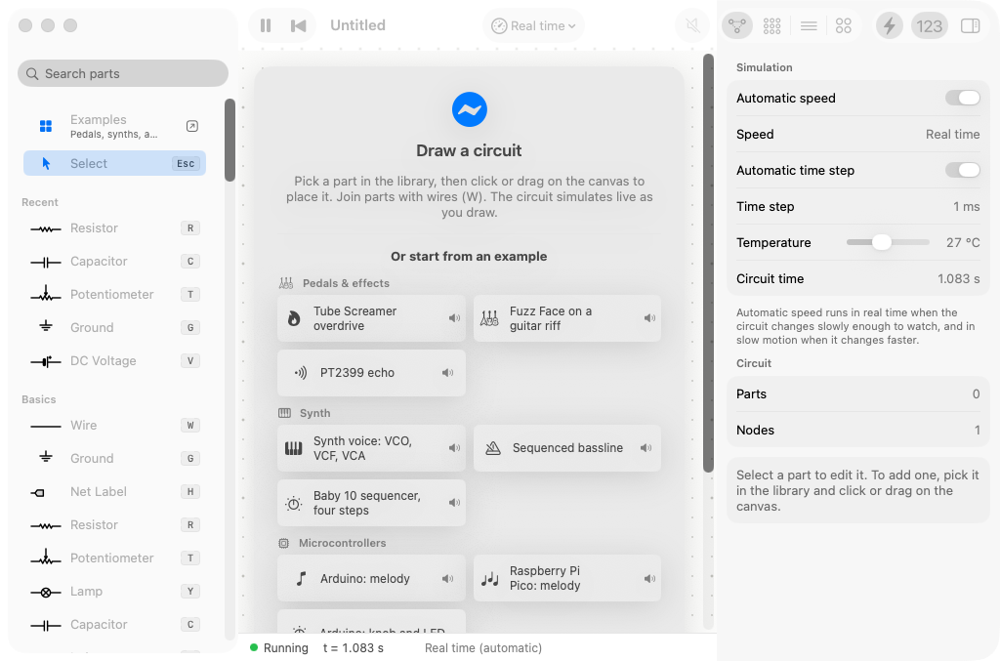

# JSpice for Mac

A native macOS circuit simulator in the spirit of iCircuit and the Falstad applet: draw a circuit and watch it run live, with voltages shown as colour and current as moving dots. Underneath is a modified-nodal-analysis engine checked against ngspice, with real-part models of op-amps, transistors, tubes, synth chips and audio ICs, microcontrollers that run real firmware, and sound: put a speaker in a circuit and hear it, or play it from a keyboard. It comes with 94 examples, from an LED and a switch to guitar pedals, synth voices and Eurorack firmware.





## Install

Download `JSpice-<version>-macOS.zip` from the [Releases page](https://github.com/raphschwarz/jspice/releases) (no GitHub account needed), unzip it and move JSpice to Applications. It runs on macOS 14 or later, on Apple Silicon and Intel Macs. To check the download, run `shasum -a 256 JSpice-<version>-macOS.zip` in Terminal and compare it with the release's `.sha256` file.

The release notes say whether that build is notarized. A notarized build has been checked by Apple and opens normally. If a build is not notarized, macOS refuses to open it the first time: right-click JSpice and choose **Open**, or allow it under **System Settings ▸ Privacy & Security ▸ Open Anyway** (or run `xattr -dr com.apple.quarantine /Applications/JSpice.app`).

Until the first release is published, the same zip is the `JSpice-macOS` artifact of the latest successful run of the [`macos` workflow](https://github.com/raphschwarz/jspice/actions/workflows/macos.yml) (needs a GitHub login). **JSpice ▸ About JSpice** shows the version you have, and **JSpice ▸ Check for Updates…** asks GitHub for a newer one, only when you choose it. What changed in each version is in [CHANGELOG.md](CHANGELOG.md).

## Your first circuit

1. **Open JSpice.** A new window says *Draw a circuit* and offers a few examples by interest; click one to see it run, or start drawing. The part library is on the left, the inspector on the right.
2. **Place parts.** Press `V` and click on the canvas for a DC voltage source, `G` for a ground under it, then `R` (resistor), `E` (LED) and `S` (switch), dragging each to set its length and direction. Every part has a key, shown next to it in the library; or click a part there, or press ⌘K and type its name ("TL072" works too). `Esc` goes back to selecting.
3. **Connect them.** Parts connect where their ends meet. Drag from an end that touches nothing (it is ringed as the pointer passes) to draw a wire back to the source's other end. Double-click a part to type its value (`4k7`).
4. **Watch it run.** The circuit simulates as you draw: the LED glows, wires turn green for positive voltage, and dots show the current. Click the switch to turn the LED off and on. Right-click the LED ▸ **Add Voltage Scope** to plot it in the dock under the canvas. If something is wrong, a banner names it: click it for the **Problems** tab.
5. **Keep it.** ⌘S saves it as a `.jspice` file. Every edit can be undone, and **Help ▸ Keyboard Shortcuts** (⌘/) lists the keys.

## What you can do

- **Hear it**: add a speaker and press **Sound**; feed in a guitar riff, a sound file or the Mac's live input; play keyboard sources from the Mac's keys, a MIDI keyboard or a step sequencer ([guide](docs/guide.md#sound)).
- **Turn knobs**: a front panel of knobs and switches in the dock's **Panel** tab, MIDI Learn, knobs that move by themselves ([guide](docs/guide.md#front-panel-midi-and-moving-knobs)).
- **Measure**: scopes, I–V curves, live frequency response with tolerances and knob sweeps, noise, loop gain and stability, spectrum and distortion ([guide](docs/guide.md#scopes-and-analyses)).
- **Use real parts**: TL072s, LM13700s, BBDs, a PT2399, tubes, CEM chips, CMOS logic, codecs and DACs, each chosen in the inspector's **Model** menu ([parts](docs/parts.md)).
- **Run firmware**: Arduino sketches on an ATmega328P, ATmega2560, ATtiny85 or RP2040, and Mutable Instruments' firmware on STM32s, with a serial monitor, bus trace and GDB server ([microcontrollers](docs/microcontrollers.md)).
- **Reuse circuits** as blocks, parts of their own ([guide](docs/guide.md#blocks-circuits-as-parts)).
- **Build it**: breadboard, stripboard and perfboard layouts checked against the schematic, printable sheets and a KiCad netlist ([guide](docs/guide.md#breadboard-stripboard-and-perfboard)).
- **Exchange it**: SPICE netlists in and out, makers' op-amp models, schematics read from a photo or PDF, an Audio Unit for music apps ([SPICE](docs/spice.md), [guide](docs/guide.md#files-import-and-export)).
- **Start from an example**: 94 circuits by category ([examples](docs/examples.md)).
- **Find what is wrong**: problems that name their parts and say what to do ([guide](docs/guide.md#problems)).

## AI control

JSpice comes with an MCP server, so an agent such as Claude can build, simulate and measure circuits in the open window while you watch, with JSpice asking before an agent takes control. Copy the configuration from **JSpice ▸ Settings ▸ AI Control**; the setup, the consent settings and all 52 tools are in [docs/mcp.md](docs/mcp.md).

## Build from source

Requires Xcode 15 or later.

```
cd macos
swift test                 # simulation engine tests
./scripts/bundle.sh        # builds build/JSpice.app and build/JSpice-macOS.zip
open build/JSpice.app
```

How the package is laid out, tested and checked in CI is in [CONTRIBUTING.md](../CONTRIBUTING.md); how the engine works and is validated against ngspice is in [docs/how-it-works.md](docs/how-it-works.md).

## Limitations

Transient and small-signal analysis only (no DC sweep), device models that are approximations of the real parts, and microcontrollers that are bus masters only: the full list is in [docs/limitations.md](docs/limitations.md).

## More

[Using the app](docs/guide.md) · [Parts](docs/parts.md) · [Examples](docs/examples.md) · [Microcontrollers](docs/microcontrollers.md) · [SPICE](docs/spice.md) · [AI control](docs/mcp.md) · [How it works](docs/how-it-works.md) · [Limitations](docs/limitations.md) · [Shortcuts](docs/shortcuts.md) · [Accessibility](docs/accessibility.md) · [Audio Unit checklist](docs/audio-unit-checklist.md)
