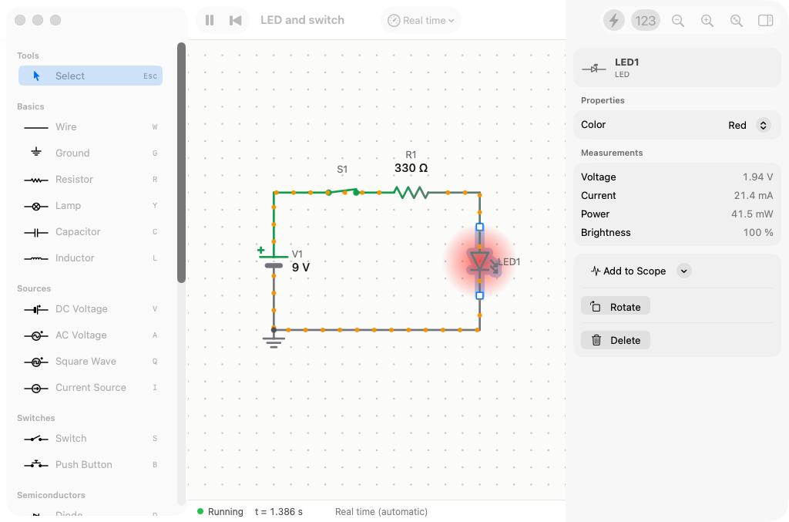
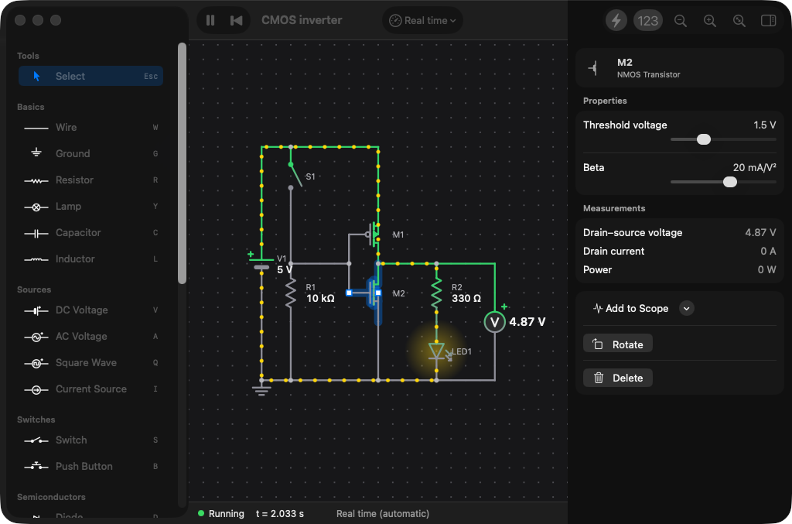
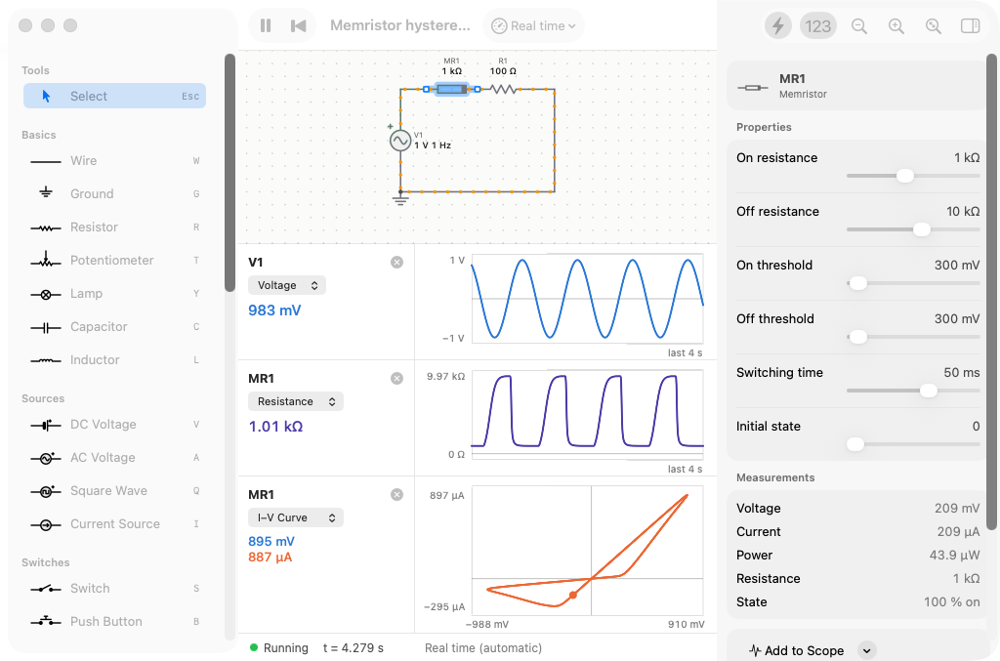
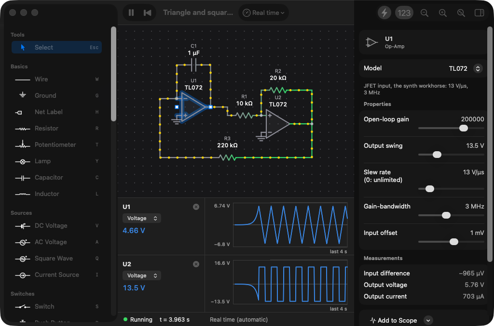
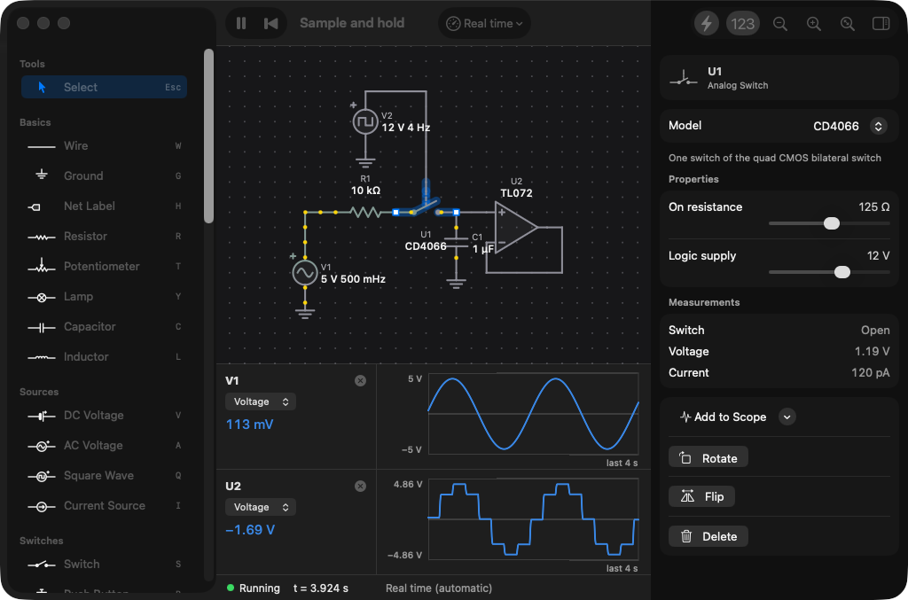
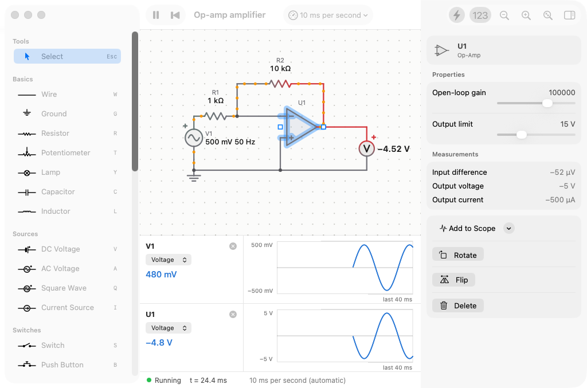
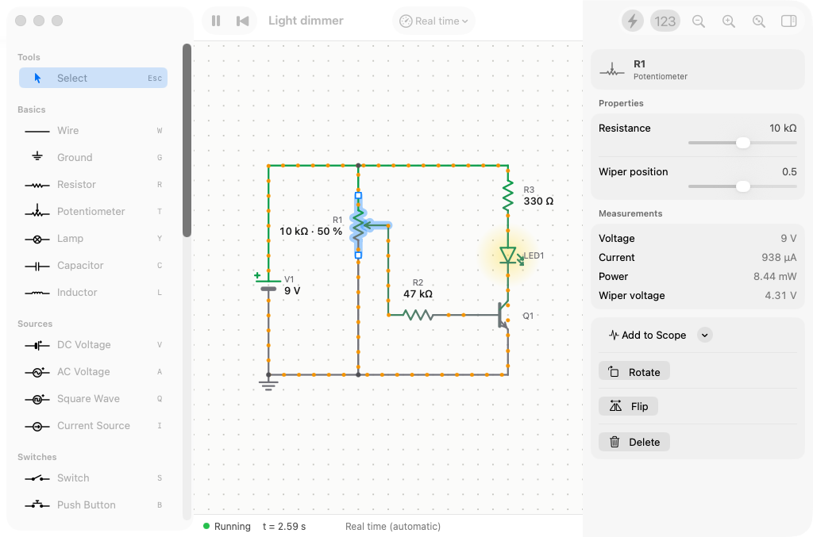
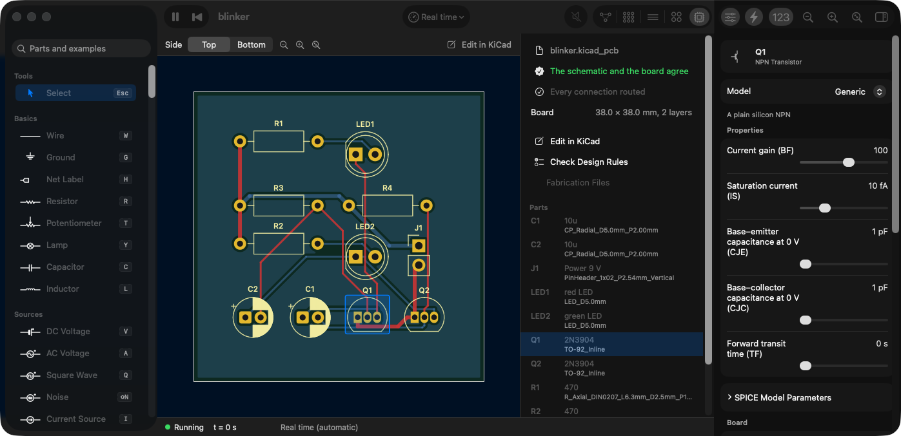
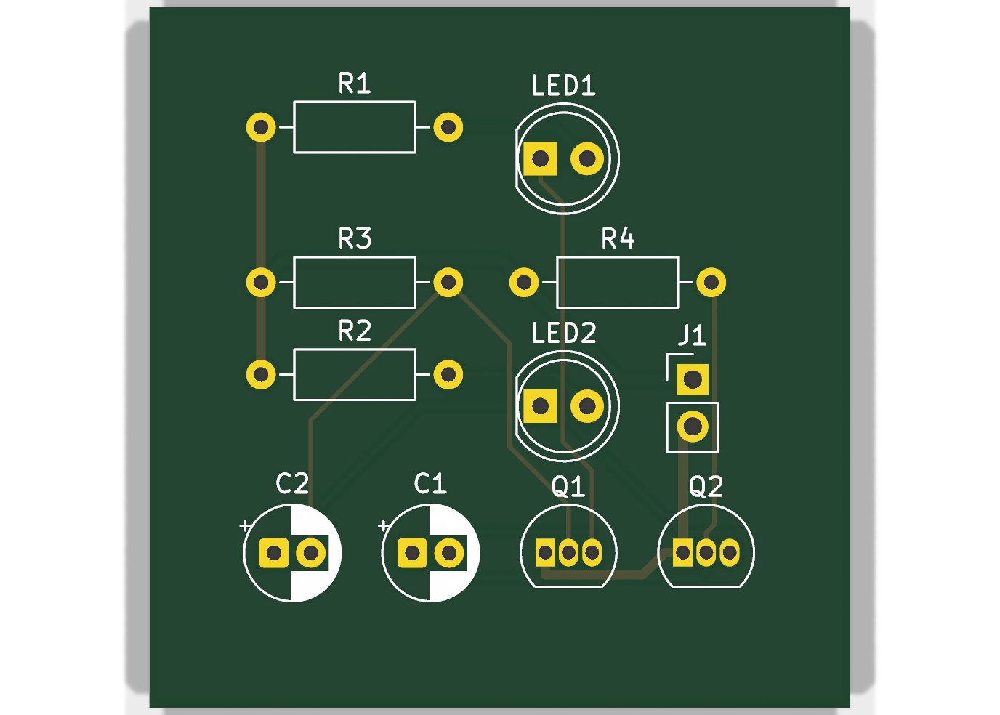

# JSpice for Mac

A native macOS circuit simulator in the spirit of iCircuit and the Falstad applet: draw a circuit and watch it run live, with voltages shown as colour and current as moving dots.



## Features

- **Fast, keyboard-first editing.** Every part has a shortcut (a letter for the common ones, ⇧ and a letter for the rest; they are shown in the library and in Help ▸ Keyboard Shortcuts, ⌘/). ⌘K or / opens a palette: type a part's name, its category or a real part it models ("TL072", "LM13700", "vactrol") and press Return. While placing, a ghost of the part follows the pointer and a pill says what you are placing. Arrow keys nudge the selection (⇧ for five units), ⌘D duplicates it, Tab steps through the parts, and the library can be searched.
- **Draw circuits directly.** Pick a part in the library (or press its key: `R` resistor, `C` capacitor, `W` wire, …), then click to place it or drag to set its length and direction. Parts connect where their ends meet, and a part dropped onto the middle of a wire joins it with a T-junction (wires that merely cross stay apart). Wires stretch when you move the parts they connect.
- **Live simulation.** The circuit simulates while you draw. Voltages are coloured (green positive, red negative, grey at 0 V), current flows as dots, LEDs and lamps glow, and memristors show their internal state.
- **Real time when possible.** Circuits that change slowly enough to watch run in real time (a capacitor charging over a second, a 1 Hz memristor loop). Faster ones run in slow motion automatically, for example a 100 Hz filter at 5 ms per second, and the status bar says so. If a circuit is too heavy to keep up, it runs as fast as it can and the status bar shows how far behind it is. You can also set the speed yourself.
- **Interact while it runs.** Click switches, hold push buttons, scroll over a potentiometer to turn it, and drag sliders in the inspector to change values live.
- **Hear it.** Put a speaker across an output and press **Sound** in the toolbar: the circuit runs in real time, one simulation step per audio sample, on a thread of its own, and you hear it through the Mac's output (with a DC blocker and a soft limit, so a stuck rail is silent and nothing clips harshly). Turn a potentiometer or flip a switch while it plays. The speaker's **full scale** sets the voltage that plays at full volume.
- **Play sound into it.** The **Audio In** source (⇧P) plays a sound into the circuit: a built-in guitar riff, any sound file macOS can read (WAV, AIFF, MP3, AAC…, mixed to mono, up to a minute, kept in the circuit file) chosen in the inspector, once or looped, or the Mac's **live input** while sound is on, so a guitar through an audio interface plays the circuit in real time. Its **level** is the voltage of full scale (0.5 V by default, about a guitar's pickup). **File ▸ Export Sound…** renders the speaker to a 24-bit WAV file offline, as long as you like and however heavy the circuit is, through the same DC blocker and soft limit as the live sound. The **Fuzz Face on a guitar riff** example puts it together.
- **Play it.** The **Keyboard Pitch** source puts out 1 V per octave (0 V at C2) and the **Keyboard Gate** source a gate while a key is held. With sound on, play them from the Mac's keyboard (A W S E D F T G Y H U J K O L P ; as in GarageBand; Z and X change octave) or from any MIDI keyboard (notes and pitch bend). The newest key sounds, and the pitch stays on the last note after release; give the pitch some **glide** for portamento. A **step sequencer** (in the inspector when the circuit has a keyboard source) plays them by itself: up to 32 steps of notes or rests at a sixteenth note each, with tempo and gate length; it keeps time with the circuit, so it is exact with sound on and in automated simulations. The **Keyboard VCO** example is a real 1 V/octave oscillator (a PNP exponential converter and an LM13700 triangle core), and **Mono synth** plays its square wave through an LM13700 VCA opened by an attack–release envelope (the gate charges it through a DG411 switch).
- **Front panel.** Below the schematic, the circuit's potentiometers, switches and push buttons appear as hardware controls on a faceplate, like a plugin's interface for testing an audio circuit: knobs to drag (double-click to centre), bat toggles to flip, buttons to hold, LEDs as panel lamps, and a level meter for the speaker that turns red when the sound clips. Double-click a label to rename the part. Toggle it with **Panel** in the toolbar.
- **MIDI Learn.** Right-click a knob, switch or button (on the front panel or the schematic), choose **MIDI Learn** and move a knob, fader or button on a MIDI controller: from then on it turns that knob (across its whole travel) or flips that switch (on from 64 up), knobs inside blocks too. The mapping is saved with the circuit and shown under the control; **Forget** takes it away, Esc cancels learning.
- **Scopes** for any part's voltage, current, power or resistance over time, or its current against its voltage (an I–V curve, such as a memristor's pinched hysteresis loop).
- **Knob sweep.** On a frequency response (or a loop probe's loop gain), choose a knob under **Sweep** to draw the response with that knob at 0, 25, 50, 75 and 100 % as well, coloured from blue to orange under the response as the knob is now: a tone control's whole range, or a gain knob's effect on a loop's phase margin (the legend gives each position's margin), at a glance. Each position is a copy of the circuit settled from rest with the knob there (so a knob that sets a bias moves the operating point too) and linearised in the background; the readout under the pointer gives each position's gain. Knobs inside blocks can be swept too. The `sweep` tool does the same for an agent (`"parameter": "position"` with an `ac` measure).
- **Knob movement.** A potentiometer's inspector has **Movement**: **Move back and forth** turns the knob from one position to the other and back by itself, once every quarter second to 16 s, slowing at each end as a foot rocks a wah pedal, while you listen and watch the scopes; **From** and **To** set its range. Right-click a knob on the front panel for **Move Back and Forth** too. It goes back where it was when it stops, and **File ▸ Export Sound…** records it moving. `simulate` and `render_audio` take `"knobs": [{"part": "WAH", "period": 2, "low": 0, "high": 1}]` for the same, the knobs moving every millisecond of circuit time.
- **Tolerances.** Tick **Tolerances** on a frequency response to shade where 24 copies of the circuit fall, their resistors drawn within 5 %, capacitors and inductors within 10 % and transistors' gain within 30 % (normally distributed, three standard deviations at the tolerance), each copy settled and linearised in the background. The `sweep` tool steps a value and measures each step; `monte_carlo` measures hundreds of copies (gain and phase, the peak and the corner, an operating point, or a waveform's level and frequency) and gives the spread, with tolerances of your choosing, part by part if need be.
- **Noise.** The frequency response also gives the noise at that output from 20 Hz to 20 kHz (and which part makes most of it), and the `noise` tool gives it frequency by frequency, referred to the input too: every resistor's thermal noise, every junction's shot noise, the channel noise of field-effect transistors, tubes' noise and op-amps' input noise (TL072 18 nV/√Hz, NE5532 5, LM358 40), carried to the output through the linearised circuit, as SPICE's `.noise` does. One solve of the transposed equations per frequency gives how a current anywhere reaches the output, so all the sources cost one solve. It matches ngspice's `.noise` within 0.01 dB.
- **Loop gain and stability.** A **Loop Probe** (in the instruments) breaks a feedback loop where it is placed: its *in* on the side that drives the loop (an op-amp's output), its *out* on the side driven (the feedback network); in the built circuit it is a link, and in a SPICE deck the 0 V source SPICE breaks loops with. Scoped as **Loop Gain**, it plots the loop gain T (the return ratio) from 1 Hz to 10 MHz with the phase margin, crossover and gain margin, and the `loop_gain` tool gives the same with every crossing. T comes from Middlebrook's double injection on the circuit linearised where it settles: a voltage injected in series at the break gives Tv = −v(in) / v(out), a current injected into it Ti = i(in) / i(out), and T = (Tv Ti − 1) / (Tv + Ti + 2), exact with loading on both sides of the break (a transconductance between two resistors reads gm (Rx ‖ Ry), where a voltage injection alone reads gm Rx + Rx / Ry). The phase margin is taken where |T| falls through 1 (or rises through it, below an AC-coupled loop's band, as the lead left), the gain margin where T's phase crosses −180° nearest crossover; an op-amp closing its loop through two RC sections reads both where the formula puts them. The **Op-amp stability** example drives a cable's 100 nF through 100 Ω with its feedback taken from the cable: the probe shows 6° of margin and the square wave rings; with 1 nF of cable the margin is back to 53°.
- **Impedance.** The `impedance` tool gives a node's impedance against frequency (a 1 A test current into it, every source at rest: an amplifier's output impedance, a filter node's), or what a source sees looking into the circuit (its input impedance).
- **Part stress.** The `stress` tool runs the circuit from rest and checks each rated part over the run, as a smoke test: resistors' and lamps' average power against their rated power (a resistor's is ¼ W unless set), capacitors' voltage against their rated voltage (where one is set), diodes and LEDs reversed past their model's breakdown voltage; with the parts that take the most power. The inspector shows a rated part's present share of its rating, orange past half and red past all of it. Nothing is assumed of a part with no rating: a transistor's, a pot's or an op-amp's limits are not checked yet.
- **Spectrum and distortion.** Right-click a part and choose **Add Spectrum**: a spectrum analyser of its voltage (or current), live, with the fundamental, the total harmonic distortion (harmonics 2 to 10) and the RMS level, each harmonic marked on the curve and a readout under the pointer. It analyses the last eight scope windows of the signal, sampled evenly and taken through a Hann window, up to the highest frequency the simulation's steps can show. Turn a fuzz's gain and watch the harmonics climb.
- **Blocks: circuits as parts.** Give a circuit a **Port** part (in the library's Blocks section) for each of its inputs and outputs and choose **Circuit ▸ Save as Block** (⇧⌘B). It joins the library's Blocks section, and from there it can be placed in any circuit as one part: a box with the ports as its pins, inputs on the left and outputs on the right (by each port's side, or by where it is drawn). Every copy is a whole circuit of its own, with its own state and its own knobs: they appear in the inspector and on the front panel under the block's name. Blocks can contain blocks. Net labels inside a block stay inside it (only ground is shared), so two copies never join by accident. Right-click a block to open it as a circuit, change it and save it again, then **Update from Library** its copies. A circuit file keeps its blocks in it, so it opens anywhere. The simulation puts each block's parts in its place, so a block behaves exactly as its parts drawn out would.
- **Frequency response, live.** Right-click a part and choose **Add Frequency Response** for a Bode plot of its voltage from 10 Hz to 100 kHz: gain in dB and phase, from the circuit's signal source (or any source you pick), with a readout under the pointer and the peak alongside. It is a small-signal analysis like SPICE's `.ac`, made around the circuit's operating point: a copy of the circuit with the driving source held still settles in the background and follows every change. Turn a filter's cutoff or resonance knob and watch the curve move, or turn a fuzz's bias and watch its gain change.
- **Library of parts:** wire, ground, net label, resistor, potentiometer, lamp, capacitor, inductor, DC/AC/square-wave voltage sources, current source, switch, push button, diode, Zener diode, LED, NPN and PNP transistors, NMOS and PMOS transistors, N- and P-channel JFETs, op-amp, OTA, analog multiplier, 555 timer, Schmitt inverter, analog switch, CMOS logic (gates, D flip-flop, decade and binary counters, analog multiplexers, phase-locked loop), unbuffered CMOS inverter, bucket-brigade delay line, digital echo (PT2399), vactrol, comparator, synth chips (VCO, VCF, ADSR envelope, VCA, sample and hold, clock divider), microcontrollers (ATmega328P / Arduino Uno, ATmega2560 / Arduino Mega, ATtiny85, RP2040 / Raspberry Pi Pico, STM32F405, STM32F373, STM32F103), a WM8731 audio codec, a CV DAC (DAC8568, DAC8564, DAC8552, DAC8551, DAC7554), memristor, voltmeter probe, ammeter, speaker, keyboard pitch and gate, white noise, audio input, triode, pentode, transformer. Transistors, op-amps, OTAs, chips and potentiometers can be flipped as well as rotated.
- **Microcontrollers that run your code.** Put a microcontroller in a circuit, write a sketch as in the Arduino IDE (`setup()`, `loop()`, `pinMode`, `digitalWrite`, `analogRead`, `analogWrite`, `delay`, `millis`, `tone`, `Serial`…) and upload it (⌘U). The sketch is compiled with the board's real compiler and Arduino core, and the chip runs the firmware instruction by instruction. Its pins drive the circuit through their output resistance and read it with real logic thresholds and optional pull-ups (and pull-downs on the Pico).
  - **ATmega328P** (the Arduino Uno's chip, pins D0–D13 and A0–A5 as on the board), **ATmega2560** (the Arduino Mega: D0–D53 and A0–A15, six timers, four serial ports) and **ATtiny85** (PB0–PB5, numbered 0–5 in the sketch; 8 MHz, no serial port): one AVR emulator with each chip's layout, at 16 MHz (8 MHz for the ATtiny85): timers and PWM, the ADC, the USARTs (the first is shown in the inspector's serial monitor), SPI and two-wire (I²C) as masters (on the Uno and the Mega: `SPI` and `Wire` clock their bits out on the pins at the rates they set, and an I²C address is acknowledged only if something in the circuit pulls SDA low), external and pin-change interrupts and EEPROM. It was checked against simavr instruction for instruction over millions of instructions of real sketches on all three chips. Each opcode is decoded once, into a table; a timer takes the ticks that only count all at once, and is looked at only at its compare matches, TOP, BOTTOM and overflows (and where the program reads its counter, as `micros()` does), which made the Arduino examples a sixth to a third faster; a busy-wait (a loop polling a flag that an interrupt or a peripheral sets) is counted at once up to the next event, all to the same cycle; and the interpreter runs inside the run's loop rather than being called for every instruction (a tenth faster).
  - The Uno's part can be set to the **ATmega168** or **ATmega88** (the same pins with less memory; the 88's interrupt vectors a word each), as in Eurorack modules' AVR firmware (Mutable Instruments' Branches, the 4ms Rotating Clock Divider), and to another clock (Mutable Instruments' Grids runs its 328P at 20 MHz): sketches are built for the chip and clock it is set to. **Load Firmware…** (or `load_firmware`) loads a firmware file built elsewhere, an Intel HEX file or a raw image, as a programmer flashes it.
  - **RP2040** (the Raspberry Pi Pico: GP0–GP22 and GP26–GP28, 3.3 V, the LED on GP25): a port of [rp2040js](https://github.com/wokwi/rp2040js) running arduino-pico firmware at 125 MHz: the Cortex-M0+ core, timers and alarms, PWM, the ADC, GPIO interrupts, DMA, the hardware divider and interpolators, SPI and I²C controllers as masters (bit by bit on the pins, like the AVR's), and the USB controller, with a simulated computer at the other end of the cable so `Serial` reaches the serial monitor. PIO state machines (behind `tone()` and the I2S library) run in simulated time at their clock dividers, each block visited only once one of its instructions falls due. Checked against rp2040js to the nanosecond on real sketches. The core runs its instructions in stretches up to the next alarm or PIO instruction, the clock ticked once for each stretch (and brought up to date whenever an instruction reaches a peripheral), to the same nanosecond as ticked after every instruction; with the interpreter inside that loop, the Pico examples run a sixth faster.
  - **STM32F405** (Mutable Instruments' Rings, Clouds, Elements, Warps and Marbles; 49 pins of the 64-pin package, 3.3 V): runs firmware built with its maker's tools, loaded as the HEX file their makefiles leave (Load Firmware…; a firmware built to sit behind a bootloader starts from its own vector table). An ARM Cortex-M4 core with its FPU, in C (`Sources/CortexM4`), checked instruction by instruction against QEMU's Cortex-M4 (fuzzed: Thumb, Thumb-2, the FPU's flags and NaNs, IT blocks) and by a self-test of its interrupts, priorities and FP context; around it the chip's peripherals at their registers (RM0090): the clock tree and PLLs, flash with sector erase and programming (a firmware's saved settings), GPIO, EXTI, both DMA controllers, the ADCs, timers (update and compare events, PWM on their pins), SPI and I²S with the full-duplex extensions, I²C, the USARTs (USART1 on the serial monitor), the DAC and RNG. Its I²S frames go to a **WM8731** codec part wired to its I²S and I²C pins, whose line outputs and inputs sit about half its supply at 1 V RMS full scale. Rings, Clouds, Elements, Warps and Marbles boot and run from Mutable's own firmware; CI builds Rings from Mutable's repository and plays it, strummed, through the codec (`tools/arm-reference`). About 90 million instructions a second where it is developed, where Rings runs at about three quarters of real time.
  - **STM32F373** (Plaits, Stages, Tides 2; 53 pins of the 64-pin package, 3.3 V): the same core around the F373's peripherals (RM0313): its clock tree, flash in 2 KB pages, DMA in channels, its 12-bit ADC and its three 16-bit sigma-delta ADCs (injected groups, single-ended or differential, by DMA), SPI and I²S, the USARTs (USART3, Mutable's debug port, on the serial monitor) and timers 2–19. Plaits boots and drones at middle C from Mutable's firmware into a **PCM5100** on its I²S pins, at about three times real time where it is developed; Tides 2 loops into its **DAC8564** and Stages streams its six CVs to its **DAC8568** (the octal CV DAC part: the words these modules send over I²S, a DAC8568 word each frame, a DAC8564 word each PCM word). CI builds Plaits and Tides 2 and checks Plaits' pitch and Tides 2's swing and rate. Its I²C is kept, not run.
  - **STM32F103** (Braids, Peaks, Frames, Streams; 35 pins of the 48-pin package, 3.3 V): a Cortex-M3, run as the M4 without its FPU, around the F1's peripherals (RM0008): its GPIO (CRL and CRH) and AFIO, its clock tree, flash in 1 KB pages, DMA1, two ADCs, timers 1–4, SPI, I²C and USARTs (USART1 on the serial monitor). Their DACs on SPI are the CV DAC part (a word after each fall of its SYNC, on any of the chip's pins), and an MCP3204 or MCP3008 on an SPI port answers the chip frame by frame. Braids plays its first shape into its DAC8551 at 96 kHz, reading its CVs from its MCP3204 (CI builds it and checks its pitch); Peaks, Frames and Streams run their DACs at 48, 32 and 31 kHz a channel.
  - On all three STM32s, a converter (codec, DAC, ADC) is reached only as the firmware has set the chip up, as on a board: each of its terminals must be on a pin carrying the matching signal of one port, by the pin's alternate function (or the F103's remaps, from ST's own pin data: `tools/arm-reference/pinmap.py`), and the port must run in a mode the part takes (an SPI DAC's data changing on SCLK's rising edge, an ADC's on its falling one, MSB first, the chip the master; a PCM5102 sent I²S or left-justified frames; a WM8731 given its MCLK). When the chip's frames flow and a part wired to it is not reached, the circuit's problems say which terminal is on which pin, what the firmware has that pin carry, and what it would need, and the part gets nothing: a board wired or programmed wrong does not seem to work. An SPI port as a master drives its SCK (at its idle level) and MOSI, and puts each frame on them edge by edge, in its mode, so that the parts that take their bits from the pins (a 74HC595, an MCP4921 or MCP4822) take them from the chip's SPI as they do from its GPIO writes, the clock and its edge checked as above (MCP3x0x ADCs work bit-banged too); a **74HC165** (the parallel-in shift register that reads a panel's buttons and switches) shifts its inputs onto the port's MISO, which the port reads just before each sampling edge, so a firmware reading it in the wrong SPI mode misses D7 as on the board; an MCP4725 answers on an I²C bus, as does a **PCA9685** (sixteen 12-bit PWM outputs for a panel's LEDs: its registers written and read through the chip's I²C or bit by bit from GPIO writes, its outputs switching at its prescaler's rate between their ON and OFF counts, asleep from reset as the chip is). What the firmware reaches that the model does not run is said too (a peripheral it leaves out, such as CAN, USB or SDIO; one whose registers it keeps without running them, such as the F373's I²C; an address where the chip has nothing), with where in the firmware it first did. The independent watchdog runs on all three: a firmware that stops reloading it is reset when it runs out, as is one that asks for a reset (SYSRESETREQ), its RAM kept and RCC_CSR saying why, and the circuit's problems say how often. The inspector's **Bus Trace** shows what goes over the chip's buses as a logic analyzer would decode it (each SPI and I²S frame, I²C address, byte and stop with its acknowledge, USART byte, with its time), and **Pins** what each pin carries as the firmware has set it up. **Debugger** starts a GDB server for the chip, as a debug probe's server: `arm-none-eabi-gdb firmware.elf -ex "target extended-remote localhost:3333"` (or an IDE's debugger) then sets breakpoints, steps, reads and writes registers (the FPU's too) and memory, loads firmware into flash and resets the chip (`monitor reset`), while the firmware runs in the circuit. Halted, the core runs no instructions, but the chip's clock and peripherals run on with the circuit, as on a chip whose debug freeze bits are clear.
  - **Chip Support** (Circuit menu): installs the compiler and the core the first time, downloaded and checked against their checksums into JSpice's Application Support folder; nothing else to install. For the AVR chips, avr-gcc and the Arduino AVR core from Arduino's package index (about 40 MB); for the Pico, arm-none-eabi-gcc and Earle Philhower's [arduino-pico](https://github.com/earlephilhower/arduino-pico) 6.2.0 from its package index (about 240 MB). An Arduino IDE already on the Mac is used too.
  - Logic parts wired straight to a chip's pins see everything the chip does on them, however fast. The chip logs those pins' changes as it runs: the AVR after each instruction and at each SPI and two-wire event within one, the Pico as its GPIOs change. The simulator plays them into the logic parts in order. An SPI word clocked out at 8 MHz, sixteen bits within one step of the circuit, reaches an MCP4921 DAC bit by bit.
  - The examples come with their firmware built in, so they run without Chip Support.
- **Synth parts with real-part behaviour.** One op-amp symbol, one OTA symbol and so on, with the specific part chosen in the inspector's **Model** menu:
  - Op-amp: Ideal, TL072, LM358, NE5532, LM741 (open-loop gain, output swing, slew rate, gain-bandwidth and input offset, so an LM358 visibly slews where a TL072 does not), and the pedal ones: JRC4558 (the Tube Screamer's), LM308 (the RAT's, slewing at 0.3 V/µs), CA3130, CA3140, TL074, TL064, OPA2134, LM833; and those of Eurorack modules: NJM2068 (4ms'), OPA1652, OPA2171, and on 3.3 V the rail-to-rail MCP6002 and LMV358 that scale CVs into a microcontroller's ADC. An op-amp can swing about half a single supply, as in a 9 V pedal. A model is found by the other names its part goes by: the quad of a dual (TL084, MCP6004, OPA4171), another maker's (NJM4558, V2164) or a newer grade (LME49720); the name kept is the one shown first.
  - OTA: LM13700 or CA3080 (output current I_abc·tanh(V_in / 2V_T), bias pin one or two junctions above V−, output clamps below the supply).
  - Multiplier: AD633 and MPY634 (out = x·y / 10 V, softly limited), for ring modulators and VCAs.
  - Bucket-brigade delay line: MN3207, MN3008, MN3005 (delay = stages / 2·clock), for chorus, flanger and echo. Its clock is either its own, swept by a control voltage, or the one on its clock pin, as on the real chip: then it takes a sample at each clock cycle and moves its buckets along, holding the sample at its end. Driven by an MN3101 or MN3102 clock driver (CP1 and CP2 in antiphase at about 1 / (2.2 R C), R from RX; an LFO through a resistor into RX sweeps it; VGG at 14/15 of the supply), it counts the driver's cycles exactly however long the steps are, so a 500 kHz flanger clock works at an audio step. The MN3011 has six taps (396, 662, 1194, 1726, 2790 and 3328 stages).
  - Digital reverbs: the FV-1 effects processor with its eight ROM programs (chorus, flange and tremolo with reverb, pitch shift, pitch-echo, test, two plate reverbs after Dattorro), its three pots as Spin assigns them, at 32.768 kHz through clipping converters, with stereo outputs. Spin's code is not published, so the programs are rewritten. The Belton BTDR-2H brick: a spring's sound from delay chips, wet only.
  - Digital echo: PT2399. The resistance from pin 6 to ground sets the delay, as on the chip: about 11.5 ms per kΩ plus 24 ms, so 31 ms at 600 Ω and 342 ms at 27.6 kΩ, as in its datasheet. Pin 6 is modelled as an internal reference behind about 2.1 kΩ, so a control voltage through a resistor modulates the delay too. The longer the delay, the slower the chip's clock, so its echo gets darker (about 20 kHz of bandwidth at 30 ms, 2.4 kHz at 340 ms) and noisier.
  - Vactrol: VTL5C3, NSL-32 (an LED and an LDR whose resistance follows the light with separate attack and decay times), for lowpass gates, compressors and opto tremolo; and the H11F1 photo-FET optocoupler, a FET channel under 200 Ω at 16 mA that follows its LED within tens of microseconds.
  - Synth chips, each worked out once per step from its inputs (so they cost almost nothing to simulate):
    - VCO: AS3340 (CEM3340): one volt per octave with exact tracking, saw, triangle, pulse (width from ±5 V on PW) or sine, PolyBLEP-smoothed so high notes do not alias.
    - Function generators: XR2206 (sine or triangle and square at 1 / (R C), amplitude modulation on its AM input), ICL8038 and LM566, the frequency set by the timing current as on the chips.
    - VCF: AS3320 (CEM3320), SSM2044, IR3109 (Roland's): four-pole 24 dB/octave low-pass with soft saturation, one volt per octave, resonance up to self-oscillation.
    - Envelope: AS3310 (CEM3310): ADSR with gate and retrigger inputs and analog-style exponential curves (attack reaches the peak in the attack time; decay and release go nine tenths of the way in theirs).
    - VCA: SSM2164 (exponential, −33 mV/dB) or linear (unity gain at 5 V).
    - Sample and hold: clocked (samples on each rising edge) or LF398 (tracks while high, holds while low, with droop).
    - Comparator: LM393 (pulled up to 5 V), LM311 (±12 V), with hysteresis.
    - Clock divider: CD4013 (÷2, a sub-oscillator), CD4017 carry out (÷10), CD4040 (÷16), with a reset input.
    - Noise: white, or the MM5837's 17-bit shift register, as in drum machines.
    - The LM3900 Norton amplifier, built from its transistors: its inputs are junctions, and it amplifies the difference of their currents.
  - Tubes, with Norman Koren's equations (smooth, fitted to the published curves) and the capacitances between their electrodes (so a 12AX7 stage rolls off its top end through the Miller effect as a real one does):
    - Triode: 12AX7 (ECC83), 12AT7, 12AU7, ECC88. The grid draws current above the cathode, so an overdriven stage biases itself as in a guitar amp.
    - Pentode: 6L6GC, EL34, with their screen grids.
  - Transformer: primary inductance, turns ratio, coupling (leakage) and winding resistances; output (8 kΩ : 8 Ω), mains (230 V : 12 V) and interstage (1 : 2) presets. It blocks DC, and its low end falls off with the primary inductance.
  - Diodes: 1N4148, 1N4001, 1N34A and OA90 (germanium), BAT41, 1N5817, 1N5819 and BAT54 (Schottky; the BAT54S is two in series, the clamp on Eurorack inputs). Zener: a plain 5.1 V one and the LM4040 precision shunt references (2.5 V and 10 V), their voltage at 100 µA held within 10 mV up to 15 mA.
  - Junctions have SPICE's capacitances: each diode's, LED's and transistor junction's depletion capacitance, which falls as it is reverse biased, and the charge a forward current stores for its transit time, which a 1N4001 must give back before it blocks, and which makes a BC108's collector roll off its top end through the Miller effect. The real parts carry their datasheet values.
  - **Temperature** (in the inspector with nothing selected, or `set_temperature`): diodes, LEDs, transistors, JFETs and MOSFETs work at the circuit's temperature, from −40 to 125 °C, their saturation currents scaled as in SPICE (kT/q is 25.865 mV at 27 °C, with ngspice's constants, as a manufacturer's card assumes), so a junction drops about 2 mV less per degree hotter and a bias point drifts as it would on the bench. Transistors: 2N3904, BC547C, 2N5088, 2N5089, MPSA18, 2N2222, BC549C, BC108, 2N3906, AC128, NKT275 and OC44 (germanium), the matched SSM2212, SSM2220 and CA3046; JFETs J113 and 2SK30A; MOSFETs 2N7000, BS170 and BS250. Potentiometers: linear or audio taper.
  - Unbuffered inverter: one inverter of a CD4069UB or CD4049UB, modelled as its two transistors. Biased by a feedback resistor it is the CMOS amplifier of fuzz pedals and preamps: a gain of about 25 at 9 V, clipping softly at the rails.
  - 555 (NE555, TLC555), Schmitt inverter (one gate of a CD40106 or 74HC14), analog switch (one switch of a CD4066 or DG411), N-JFET (2N5457, J201, 2N3819).
  - CMOS logic, with the supply hidden like the 40106's and set in the inspector:
    - Logic gate: one gate of a CD4093 (Schmitt NAND, for gated oscillators), CD4011 (NAND), CD4001 (NOR), CD4081 (AND), CD4071 (OR), CD4070 (XOR), CD4077 (XNOR), 74HC132, 74HC00 or 74HC86.
    - D flip-flop: one half of a CD4013, with set and reset.
    - Decade counter: CD4017 or 74HC4017, with its ten decoded outputs, clock inhibit and carry out.
    - Binary counter: CD4040 or 74HC4040, twelve stages, counting on the falling edge.
    - Analog multiplexer: CD4051 or 74HC4051 (eight channels).
    - Analog selector: one switch of a CD4053 or 74HC4053 (two channels).
    - Shift register: one half of a CD4015, or a 74HC595 with its output latch and enable.
    - SPI DAC: MCP4921 (12 bits). Write 0x3000 plus the code with CS low and OUT goes to VREF × code / 4096. It shifts SDI in on SCK's rising edges and latches the word when CS rises, with LDAC low. The MCP4822 has two, A and B (bit 15), and its own 2.048 V reference.
    - SPI ADC: MCP3008, eight channels of 10 bits, and the MCP3208 (and the four-channel MCP3204) of 12 bits, as Mutable Instruments' modules read their CVs, the same frame with two more bits. After a start bit, single-ended or differential and the channel, it samples the input and answers on DOUT, a null bit and then the code, bit by bit as the clock runs.
    - I²C DAC: MCP4725 at 0x60 (0x61 with A0 high), in fast mode or with the write-DAC command, acknowledging each byte by holding SDA low.
    - I²S audio DAC: PCM5102, 16 to 32 bits a sample, reading each channel's word one BCK after LRCK changes, 2.1 V RMS at full scale about ground.
    - The ADC and the I²C DAC answer within a transfer: a microcontroller calls back as it logs each change to their pins, so they move on at once, and what they drive back (a DOUT bit, an acknowledge) is what the chip reads from then on.
    - Phase-locked loop: CD4046 or 74HC4046. Its VCO runs from fMin to fMax as VCO IN goes from 0 V to the supply. Phase comparator 1 is an XOR. Phase comparator 2 is the edge-triggered phase-frequency detector, driving high or low or letting its output go, so the loop filter holds while the loop is locked.
    - Plain CMOS inputs switch at half the supply, Schmitt inputs at their two thresholds. Outputs drive towards the supply or ground through their output resistance. The multiplexers connect the selected channel through their on resistance.
  - Chips that share supply pins in real life (one gate of a 40106, one OTA of an LM13700) use a hidden supply set in the inspector; the 555 has its own VCC and GND pins.
- **Audio parts: from the microphone to the speaker.** The library's **Audio** section, each part a real chip or transducer chosen in the **Model** menu, simulated as the circuit inside it (so it exports to SPICE and lays out on the breadboard like any other part):
  - Microphones: dynamic (SM58 and SM7B types, with their source impedance, speaking a synthesized voice), large- and small-diaphragm condensers that need 48 V phantom power through 6.81 kΩ per leg, and electret capsules with their JFET inside, biased through a resistor. Guitar pickups (single coil, humbucker, P-90, hot humbucker) are an inductance and resistance with the coil's capacitance, so a cable's capacitance and the volume pot shape their tone as on a real guitar.
  - Mic preamps: SSM2019, THAT1510, THAT1512 and INA217 instrumentation amplifiers, the gain set by one resistor between RG1 and RG2, with their input noise. Low-noise op-amps for discrete preamps and line stages: NE5534, OPA1612, LM4562.
  - Balanced lines: INA134, THAT1240 and THAT1246 receivers and DRV134 and THAT1646 drivers, and an XLR cable that picks up 50 or 60 Hz hum on both legs, slightly unequally, so a receiver's common-mode rejection can be heard working (or a single-ended input heard failing).
  - Headphone and power amps: NJM4556 and TPA6120 headphone drivers, the LM386, and TDA2030, LM1875 and LM3886 power amps with their output swing and slew rate. The speaker has Thiele–Small models (full-range, guitar, woofer, 32 Ω and 300 Ω headphones): its impedance rises at its resonance and with its voice coil's inductance, as an amplifier sees it.
  - Dynamics: the THAT2180 VCA (−6.1 mV/dB), the THAT2252 RMS detector (+6.1 mV/dB, so the two make a compressor with no scaling between them), the THAT4301 with both and a spare op-amp, peak and average detectors, the NE570/SA571 compander, and the SSM2166 mic preamp, which compresses above its rotation point and gates below its threshold.
  - Ring modulators and mixers: the MC1496 balanced modulator and the SA612 mixer with its oscillator, both built transistor by transistor, and centre-tapped transformers for a diode ring.
  - The 3PDT footswitch of true-bypass pedals: three poles, each joined to its bypass or its effect throw; click it like a switch.
  - The switched jack of Eurorack modules (a Thonkiconn): unplugged, its tip rests on its normal lug, so an input reads what it is normalled to; click it to plug a cable in, and the tip joins the cable's plug, which a wire takes to another jack's plug as a patch cable does.
  - Voltage regulators: LM7805, 78L05, LM7812, the negative 79L05 and LM7912, the LM1117-3.3 of a microcontroller's supply, and the adjustable LM317 and LM337 (1.25 V between OUT and ADJ, set by a divider). Each is simulated as an error amplifier holding its output at the reference through a pass transistor, which drops out at its dropout below the input, with its quiescent current drawn from the input; there is no current limit or thermal shutdown.
  - Tone: the LM1036 DC-controlled volume, bass and treble chip; passive tone stacks, the Baxandall, a gyrator graphic EQ and a state-variable parametric EQ are in the examples, built from parts.
  - Spring reverb: long and short tanks, driven at 8 Ω, 150 Ω or 1475 Ω: dispersive springs whose drips and twang come from chains of all-pass filters, as in the real tank's delay lines.
  - Meters: a VU meter (+4 dBu or −10 dBV, with the needle's 300 ms ballistics) and a peak programme meter, drawn as a needle on the schematic and the front panel, and the LM3914, LM3915 and LM3916 bar-graph drivers lighting ten LEDs.
- **Examples:** LED and switch, voltage divider, capacitor charging, RC low-pass filter, LC oscillator, half-wave rectifier, Zener regulator, light dimmer, blinking LEDs (astable multivibrator), transistor switch, CMOS inverter, op-amp amplifier, triangle and square LFO (two TL072s), OTA VCA (LM13700), 555 LED flasher, Schmitt trigger oscillator (40106), sample and hold (CD4066 and TL072), and to listen to: 555 beeper, Schmitt oscillator tone (turn the pot to change the pitch), OTA tremolo (an LM13700 VCA whose gain a slow LFO sweeps), LM13700 resonant filter (a 12 dB/octave state-variable filter with cutoff and resonance pots, on a square wave), wind (noise through that filter), effects: ring modulator (AD633), BBD chorus (MN3207), Fuzz Face (on a sine, and on a recorded guitar riff), a single-ended tube amp (12AX7 into 6L6GC and an output transformer), diode-clipper overdrive, vactrol lowpass gate; and to play: keyboard VCO (1 V/octave), mono synth (VCO, envelope and VCA) a full synth voice (VCO through the resonant filter and a VCA, one envelope opening both), and that voice playing a sequenced bassline; synth chips: a chip synth voice (two AS3340s and a CD4013 sub-oscillator through an AS3320 and a VCA, an AS3310 opening both, playing an arpeggio), random notes (noise through a clocked sample and hold into a VCO), comparator PWM (an LM311 comparing a triangle with a slow sine); CMOS: an 8-step sequencer (a CD4093 clock, a CD4040 counter and a CD4051 picking one of eight knobs for a VCO), a four-step Baby 10 (CD4017), a CMOS drone (CD4093 oscillators, a CD4070 XOR and a CD4013 sub-octave), a PLL octave-up (a CD4046 locked to twice its input through a CD4013), a two-stage CD4049UB fuzz, a PT2399 echo with time and repeats knobs; blocks: one tone stage saved as a block and used twice, each copy with its own knob; Arduino (ATmega328P): blink, PWM fade, knob and LED with serial output, melody on a speaker, a sawtooth arpeggio sent sample by sample to an MCP4921 DAC over SPI and through a filter; Arduino Mega: a bar graph from a pot; ATtiny85: a dimmer and a breathing LED; Raspberry Pi Pico: knob and LED with 12-bit PWM and USB serial, a melody from PIO; audio: a dynamic mic into an SSM2019 preamp, a condenser on phantom power, an electret preamp, an LM386 amp, a TDA2030 power amp into a 12" guitar speaker, a headphone amp, a balanced line through a humming cable, a feed-forward compressor (THAT2252 and THAT2180), an NE570 compander, an opto compressor, a noise gate, Fender and Marshall tone stacks, a Baxandall, a graphic and a parametric EQ, an LM1036 tone control, a guitar pickup into a fuzz, a spring reverb and an LM3915 level meter; chips: a Tube Screamer and a RAT, MC1496, SA612 and diode ring modulators, a Bode frequency shifter, an XR2206 generator, an LM3900 amplifier, a 74HC595 sequencer, a BBD chorus with its MN3102 clock driver, an MN3011 multi-tap echo, an FV-1 reverb, a Belton brick reverb, an H11F1 tremolo, an SSM2166 voice, a THAT4301 compressor, a true-bypass pedal, an Arduino with an MCP4822's two LFOs, an Arduino reading an MCP3008 and writing an MCP4725, and a Pico playing a sine through a PCM5102 over I²S; memristor hysteresis, memristor programming.
- **SPICE netlists in and out.** **File ▸ Import SPICE Netlist** draws a netlist as a schematic: R, C, L, V and I sources (DC, SIN, PULSE; a 0 V source becomes an ammeter, unless a controlled source reads its current), diodes, bipolar transistors, MOSFETs and JFETs with their `.model` parameters, coupled inductors (a transformer), controlled sources (E, F, G and H with a gain, POLY, VALUE or TABLE, and B sources with V= or I=), `.param` constants, `.func` functions and `{expressions}` of them, and subcircuits (blocks) with their parameters (`PARAMS:` defaults, an instance's own values, `.param` inside them; a block for each different set), and lists what it leaves out. The model files a deck names are read from beside it: `.include file`, and `.lib file section` for one section of a library (or `.lib file` for all of it, as PSpice and LTspice read it), so a maker's model file can be imported as it comes. A diode's, transistor's or JFET's area (after its model's name, or `AREA=` and `M=`) scales its card as in ngspice. Switches are behavioural sources: PSpice's VSWITCH and ISWITCH (S and W) with the resistance its reference manual gives (its logarithm a smooth cubic between the off and on controls), and ngspice's SW and CSW read the same way between VT − VH and VT + VH, without their hysteresis (the import says so). A resistor, capacitor or inductor may name a model (PSpice's `R1 a b R_NOISELESS 1k`): its R, C or L scales the value, and a resistor at absolute zero (`T_ABS=-273.15`, as maker's macromodels mark the resistors that stand for no real one) or with `noisy=0` makes no thermal noise. **File ▸ Import Maker's Model** takes a part's model file as its maker publishes it (an op-amp's `.lib` or `.mod` from TI, Analog Devices, onsemi…, downloaded from the part's page): one of its subcircuits becomes a block in the library, its pins named as the file names them, kept with where it came from: the file's name and SHA-256 (so the very file, and its revision, can be found again), the comment lines it starts with (where makers give the part, the model's revision and its terms) and when it was imported. Makers' files are theirs to give out, so JSpice ships none: each one is imported from the maker's own download. A model with five pins (in a model's usual order: +in, −in, V+, V−, out) is measured as an op-amp at ±15 V, to set beside its datasheet: input offset voltage and supply current (as a follower), open-loop gain, gain-bandwidth product (100 times where the gain falls through 40 dB), unity-gain frequency and phase margin (in an inverting stage with its + input grounded, as datasheets measure them, so the common-mode rejection a follower would fold in stays out), slew rate on a 10 V step (10–90 % of the output's swing, from its last 10 % crossing before its 90 % one, as a follower or in an inverting stage of gain −1 as the part's datasheet measures it: an output can jump at the step's instant through the inputs' clamp diodes or its input stage, and fall back before it slews) and output swing into the load. A deck exported with such a block names its file and SHA-256 above its subcircuit. **File ▸ Download Maker's Model** fetches the parts JSpice knows where to find straight from their makers (TI's TL072, TL074, RC4558, UA741, LM358, OPA2134, OPA1612, OPA1642, OPA1656 and OPA1678 so far, `MakerModelCatalog`): the archive from the maker's site, the model file in it checked against the SHA-256 of the revision the catalog names (a newer revision is refused until it has been checked), imported, measured at its datasheet's supplies and load, and shown beside the datasheet's figures (the document, revision and table are named) and what ngspice measures on the same file (`tools/spice-reference/maker_models.py` downloads each and spells PSpice's switches, LIMIT and IF for ngspice; where ngspice gives up on a run, "timestep too small" as a model's overload sensing chatters, it tries Gear's rule and an operating point already driven, and a figure no way gives is left out), with what the model is known to get wrong: TI's 1989 TL072 model is of the original die (3.3 MHz, 13 V/µs, where today's TL07xC is 5.25 MHz and 20 V/µs) and draws 14.2 mA where the datasheet gives 1.4; the OPA1678's swings 0.3 to 0.5 V short of its datasheet's output range into 2 kΩ; the OPA1612's gain-bandwidth product is 92 MHz where its datasheet gives 80; TI's 1989 RC4558 model is the part as its datasheet gave it before its 2024 revision (3 MHz, 300 V/mV, ±13 V into 2 kΩ, where it now gives 4 MHz, 830 V/mV and ±13.8 V), and its UA741 the classic 741 (1.67 mA), where the 2026 datasheet describes TI's present die (0.13 mA); the TL074's file holds the TL072's model. CI downloads each and requires JSpice's figures to match ngspice's. An op-amp part whose model is in the catalog (TL072, TL074, LM358, OPA2134, OPA1612, OPA1642, OPA1656, OPA1678; the LM741 runs TI's UA741 and the JRC4558 TI's RC4558, the same designs) can run its maker's model in place of JSpice's own equations: the inspector's **Maker's Model** switch downloads the file once (it is kept in ~/Library/Application Support/JSpice/Maker Models, on this Mac only) and puts the model's parts in the op-amp's place, on ideal supplies (± a supply about the op-amp's midpoint, by default as the breadboard supplies it: ± the swing and 1.5 V, or a single supply's 0 V and twice its midpoint, a pedal's 9 V). The circuit keeps the model with its provenance and exports it as the model's subcircuit. Closer to the part, it is also slower, but TI's newer models play live: at 48 kHz, one step a sample, one OPA2134 takes about 6.5 µs a step on CI's Mac (3 times real time) and two in a row, as a pedal's two op-amps, about 13 µs (1.5 times real time, whose budget is 20.8 µs), two OPA1656s about 14 µs; TI's LM358 model, whose output stage switches itself off and on again about its crossover, about 14 µs (1.5 times real time: its crossings take a few iterations more than the rest of the cycle, where they took a dozen. The engine sees the stage's decisions go round in a cycle and keeps them as held; it starts a crossing that does not converge again from before its dead zone; it remembers which crossings went which way, so that the next of the same kind starts there at once; and it starts the step after a crossing from its solution rather than from a guess drawn through the bend. `jspice-mcp --benchmark-maker PART [seconds] [stages] [SWITCH=on|off…]` times one, or several in a row). **Export SPICE Netlist** writes a deck for ngspice or LTspice with JSpice's own equations: op-amps and tubes as behavioural sources, transformers as coupled inductors, blocks as subcircuits.
- **Breadboard, stripboard and perfboard.** The **Breadboard** view shows the circuit built on white solderless breadboards, full size (830 points, 63 columns), half size (400 points, 30 columns) or mini (170 points, 17 columns, no rails, so the supplies go on strips joined by jumpers), as many side by side as it needs (the choice is remembered; their rails are joined, and the bill of materials counts the boards): chips straddling the channel with every pin number from the datasheet (op-amps, gates, inverters and switches packed several to a package, spare units noted), transistors' legs in their real order with the flat face towards you (EBC for a 2N3904, CBE for a BC547C, SGD for a 2N3819), electrolytics' + leg on the higher DC voltage and a voltage rating from the operating point (or the capacitor's own rated voltage), supplies on the rails, jumpers coloured by net, and what is wired from off the board. Every layout is checked hole by hole against the schematic's nets. Hover a hole to see its net; the side panel lists each part's holes and the bill of materials (**Copy CSV**). The **Stripboard** view lays the same circuit out on Veroboard: the supplies on the top and bottom strips, parts standing across the strips, chips straddling a cut with pin 1 top left, the holes where the strips must be cut, the wire links, and pots and switches wired from the panel by their lugs; it too is checked against the schematic, and its bill of materials adds the board and chip sockets. The **Perfboard** view lays it out on perfboard, a pad round each hole and nothing joining them: the parts stand where the stripboard puts them, and where stripboard would have a piece of strip joining two or more pins, the perfboard has a trail on the copper side, the pads joined along the row by tinned copper wire (drawn silver, seen through the board); no strips to cut, the same wire links on the parts' side. It is checked against the schematic the same way, a trail run over another net's pad counting as a short, and its bill of materials gives the board's size and the wire's length. Each board view's **Printable Sheet…** (and the `board_sheet` tool) saves the board as an SVG drawing at its true size, holes 2.54 mm apart, with a ruler of ten holes to check the print's scale against: every part in its holes with its name, the strips and cuts, trails, links or jumpers, and under the board the parts with their holes, the bill of materials and the notes. Printed at 100 %, a stripboard's or perfboard's sheet can be laid over the board itself.
- **Printed circuit boards, with KiCad.** The **PCB** view (⌥⌘B) is the circuit's printed circuit board, a KiCad project beside the circuit's file, routed right there with KiCad's own router (brought over to JSpice) or laid out and routed in KiCad's PCB editor, and kept in step with the schematic both ways as Eagle and Fusion keep theirs. See [Printed circuit boards](#printed-circuit-boards) below. **PCB ▸ Export KiCad Netlist** still writes the netlist alone, for KiCad's **File ▸ Import ▸ Netlist**.
- **Audio Unit.** JSpice.app carries an Audio Unit for Logic, GarageBand, Ableton Live and any other music app: **JSpice: Circuit Effect** runs a circuit with the track's sound in its audio inputs, **JSpice: Circuit Instrument** plays one from MIDI notes on its keyboard sources (the last note held sounds). Its presets are the sound examples and every circuit saved with **File ▸ Export as Audio Unit** (kept in ~/Music/JSpice/Audio Units); the circuit's knobs and switches are the plugin's parameters, for automation, and the session saves the whole circuit. To check it in a real host, follow [docs/audio-unit-checklist.md](docs/audio-unit-checklist.md).
- **Schematic capture.** **File ▸ Import Schematic from Image or PDF** reads a drawing (a photo or scan, or the first page of a PDF) into a circuit. The page's text labels are found with their places, from the PDF itself or by the Mac's own text recognition, and Claude (claude-opus-5-5, through your Anthropic API key, kept in the login keychain) reads the drawing with them into a netlist of JSpice's parts. JSpice builds it, sends anything that doesn't build (an unknown terminal, an open pin, a net going nowhere) back for another look, and draws the result as a tidy schematic, listing the values it was unsure of and anything it left out. Check it against the drawing before trusting a simulation. How well it reads is measured on drawings of the examples: CI renders them (`JSpice --render-drawings <folder>`), and `jspice-mcp --capture-eval <folder>` reads each back and scores the parts found, their values and their connections against the example (it runs in CI when the repository has an `ANTHROPIC_API_KEY` secret).
- **A real Mac document app:** one window per circuit, open/save as `.jspice` files, autosave, undo and redo for every edit, copy and paste, export the schematic as PNG or PDF, light and dark mode.













## Printed circuit boards

JSpice takes a circuit from schematic and simulation to a board a board house can make, with [KiCad](https://www.kicad.org) (10 or later) as its layout tool: KiCad's router routes the board (in JSpice's PCB view, or in KiCad's PCB editor), KiCad's file format holds it, KiCad's libraries give its footprints and KiCad's `kicad-cli` checks it and makes its fabrication files. JSpice is what joins it to the schematic.

- **Make the board.** Save the circuit, open the **PCB** view and choose **Make Board**: through-hole or surface-mount parts, 2, 4 or 6 copper layers. The board is `circuit.kicad_pcb` (with `circuit.kicad_pro`) beside `circuit.jspice`. Each part goes on a footprint from KiCad's libraries (¼ W axial resistors or 0805s, ceramic discs, radial or SMD electrolytics sized by their capacitance, DO-35/DO-41 or SOD-123/SMA diodes, 5 mm or 0805 LEDs, TO-92 or SOT-23 transistors with their pads in KiCad's order, DIP or SOIC chips with their units packed, Alpha pots), supplies and what is wired from off the board on pin headers, in the schematic's order inside an outline round them; the supplies and ground are in a *Power* net class with wider tracks. A part's footprint can be changed in the inspector: type it, or **Choose…** one from KiCad's libraries, drawn as it will be on the board.
- **Lay it out in KiCad.** **Edit in KiCad** (⌥⌘K) opens the board in KiCad's PCB editor, in its own window: place, route, pour zones, add mounting holes and logos there as in any KiCad project. The PCB view follows the editor as you work: copper, pads, holes, silkscreen and the connections still to route, from the top or underneath.
- **Place and route it here.** The PCB view's **Route** tool (X) routes tracks as KiCad's interactive router does, because it is KiCad's router: its walkaround and shove routers, brought over from KiCad 10's C++ to Swift and checked against KiCad's own compiled code, route for route. Click a pad (or a track's end), move, click to fix the track so far, double-click to finish it; it walks round what is in the way at the clearances of the board's net classes and design rules (the KiCad project's), in 45° lines, and a dashed line shows where the net goes next. Choose **Shove** beside the width and new tracks push other nets' tracks and vias aside instead (shown where they go as you move; pads and holes stay put), as KiCad's shove mode does. A board's arc tracks are taken as KiCad's router takes them: routed from and to, walked round and dragged (an arc dragged by its middle bends, tangent to the tracks either side), and written back as arcs. Beside the width, the corners new tracks take: 45° or 90°, mitred or rounded into arcs, as KiCad's track corner mode. The **Route Differential Pair** tool (**6**) routes a pair of nets KiCad takes for one (named like USB_P and USB_N, or D+ and D-) as KiCad's does, both tracks together at the net class's diff pair width and gap, from the pad clicked and its partner; **V** takes both through vias. **V** places a via and carries on on the other side (or choose another layer), **/** flips the corner, **⌫** takes back the last fixed part, **Esc** stops (keeping what is fixed), **End** routes on to the nearest pad of the net, **W** steps the width (or choose one; by default the net class's). The **Select** tool moves parts (drag them; **R** rotates, **F** turns them over to the other side) and selects tracks and vias (⇧ for more, **I** for all of their nets') for **⌫** to delete; drag a track or a via and KiCad's dragger (brought over as the router was, and checked the same way) moves it, its neighbours following on the 45° lines (a track's end drags its corner), walking round what is in the way or shoving it aside as the router's choice is; **D** drags the one under the pointer until a click, **G** at any angle, **Esc** drops it; click a connection still to route (its line of the ratsnest lights up under the pointer) and the router routes it there and then; **Fit Outline to Parts** (in the pour menu) draws the board's edge round the parts again once they are moved, and the board's width, height and corners' radius can be typed in beside it (its outline drawn again, rounded as KiCad rounds a rectangle's corners); **Mounting Holes** puts KiCad's M2, M2.5, M3 or M4 holes in its corners (parts of the board alone, which the schematic's updates leave be; a corner with copper in the way is left without); the bar's arrows undo and redo. The **Net classes** beside the board set each class's track width, gap, via and drill, and the nets it takes: the router routes with them at once, and the board's KiCad project keeps them. The pour menu pours ground copper over the board (on the bottom, the top, both or every layer), which KiCad fills round everything else, keeping its clearances and joining the ground pads by thermal reliefs; **B** fills the zones again after the tracks change, as in KiCad, and **Stitch Ground Pours** ties the top's and the bottom's ground together with a via every 5 mm wherever both are filled and the router finds room (clear of everything else by the board's rules). The wand routes every connection still to route in one go (or all but ground, for a pour), one connection at a time as you would. While KiCad has the board open, each change goes into its editor as one change KiCad's Undo also takes back (pours by the board's file); otherwise into the board's file.
- **Change either; the other follows.** With KiCad's API on (JSpice offers to turn it on; or KiCad's **Preferences ▸ Plugins ▸ Enable KiCad API**), every change to the schematic that changes the board (a part added, deleted or given another value or footprint, a wire moved to another net) goes to the board in KiCad's open editor once the schematic rests, as one change KiCad's own Undo takes back: new footprints arrive below the board, exchanged ones keep their place, and tracks follow their pads to their new nets. Changes made on the board come back: a part renamed, given another value or footprint, or marked not to be fitted in KiCad changes the schematic, as one change JSpice's Undo takes back. Where both sides changed the same thing, the schematic's change stands. A part deleted on the board waits for your word: **Delete from Schematic** or **Put Back**. Mounting holes, logos and test points placed on the board alone stay. With KiCad closed, the board's file is changed instead. Undoing a change in JSpice takes it back on the board too.
- **Cross-probing.** Select a part in the schematic and KiCad selects its footprint; select footprints in KiCad and JSpice selects their parts. Select a wire and KiCad highlights its net. Clicking a part in the PCB view selects it in both.
- **Check and make it.** As you route, JSpice checks the board itself after each change and marks what it finds: KiCad's own checks of clearances and shorts, zones overlapping, track widths, holes and annular rings, the board's edges, keepout areas, footprints' courtyards, solder mask bridges, isolated copper and starved thermal reliefs, dangling tracks and vias, and connections still to make, brought over from KiCad 10 and checked against kicad-cli on thousands of random boards (the same violations, in KiCad's words). **PCB ▸ Check Design Rules** runs KiCad's full design rules check (zones filled first) and marks what it finds on the board. **PCB ▸ Fabrication Files** makes everything a board house needs in a folder: Gerbers for each layer and the drill files, zipped for upload, pick-and-place positions and the bill of materials for assembly, a STEP model of the board for an enclosure and a picture of it, named and formatted for **JLCPCB** (its BOM and CPL columns, with each part's LCSC number, given in the inspector's Board section, for its assembly service), **PCBWay**, **OSH Park**, or any board house.





[`docs/pcb`](docs/pcb) holds the blinker example's board: made by JSpice from the example's schematic, autorouted with [Freerouting](https://github.com/freerouting/freerouting) through KiCad's Specctra export, with a ground pour underneath. KiCad's design rules check finds no violations, nothing unconnected and no difference from the schematic; changing a resistor's value in JSpice then changes just that on the routed board.

The board is read and written as KiCad writes it, byte for byte, so a board JSpice has changed reads in KiCad as if KiCad had saved it. Bringing a board up to date with the schematic follows KiCad's own *Update PCB from Schematic*: footprints matched by their link to the schematic, exchanged in place, their fields and pads' nets updated and their tracks' nets carried along, as KiCad's netlist updater does them.


## AI control (MCP)

JSpice comes with an MCP server, so an AI agent such as Claude can design, simulate and measure circuits: a physics harness for analog design. The agent describes a circuit as a netlist (parts, models and the nets their terminals join), and JSpice draws it as a tidy schematic, simulates it and reports waveforms, measurements and frequency responses.

Circuits are drawn the way a person would: the signal flows from left to right with the main path on straight lines, sources on the left, parts to ground hanging below the line with ground symbols, pull-ups standing above it, feedback arching over its op-amp, an oscillator's loop returning along the bottom, supply rails as flags (`+12V`, `VCC`), and real wires routed around the parts, with junction dots and few bends or crossings. **Circuit ▸ Tidy Up** (⌥⌘T, or the `tidy_up` tool) redraws any circuit, hand-drawn ones included, the same way, keeping every connection.

Tools: `list_parts`, `list_examples`, `load_example`, `new_circuit`, `build_circuit` (from a netlist), `add_part`, `add_wire`, `remove_part`, `tidy_up`, `set_parameter`, `set_model`, `set_switch`, `map_midi` (a MIDI controller for a knob or switch), `set_sequence` (a step pattern for the keyboard sources), `upload_sketch` (compiles an Arduino sketch into a microcontroller, returning the compiler's errors by line), `read_serial` (what a microcontroller printed, and text to send it), `read_bus_trace` (what went over an STM32's SPI, I²S, I²C and USART buses, decoded as a logic analyzer would) and `read_chip_state` (what each of its pins carries as its firmware set it up, how often it reset itself, what it reached that the model does not run), `gdb_server` (a GDB server for an STM32's firmware), `install_chip_support`, `describe_circuit`, `simulate` (waveforms with min, max, mean, RMS, peak-to-peak and frequency for probes like `V(out)`, `I(R1)`, `V(U1.out)`; it can also play timed notes on the circuit's keyboard sources, such as `[{"at": 0, "note": "C4"}, {"at": 0.5, "off": true}]`, and move knobs back and forth by themselves), `measure`, `define_block` and `list_blocks` (make a netlist into a block, with `port` parts as its pins, and use it as `{"kind": "block", "block": "name", ...}`, as often as needed), `spectrum` (fundamental, THD, each harmonic's level and the strongest other peaks of a probe's signal), `set_audio_input` (a WAV file for an audio input to play) and `render_audio` (what the speaker hears, as a WAV file, with its peak level and how much clipped), `optimize` (part values found to meet targets: a corner frequency, a gain within a range, the most output, then moved to E12, E24 or E96 values), `import_spice` and `export_spice`, `export_kicad` (a KiCad netlist for a printed circuit board), the board tools `pcb_create` (the circuit's KiCad board beside its file), `pcb_update` (board and schematic brought together both ways), `pcb_status`, `pcb_part` (a part's footprint, whether it is on the board and fitted), `pcb_footprints` (KiCad's libraries searched), `pcb_route` and `pcb_unroute` (the connections routed with the PCB view's router, KiCad's, and tracks taken off again), `pcb_pour` (a ground pour, filled by KiCad, and stitched), `pcb_net_class` (the widths and gaps each net is routed with), `pcb_outline` (the board's size and rounded corners, or its outline fitted round the parts), `pcb_mounting_holes`, `pcb_drc` (KiCad's design rules check, or with `"engine": "jspice"` JSpice's own, in a moment and without KiCad), `pcb_render` (a picture of the board as made), `pcb_fabricate` (Gerbers, drill and assembly files for JLCPCB, PCBWay, OSH Park or any board house) and `pcb_open`, `import_model` (a maker's model file, or a part downloaded from its maker, into the block library, with its provenance and, for an op-amp, its datasheet figures measured), `list_maker_models` and `use_maker_model` (an op-amp part on its maker's model), `capture_schematic` (a drawing's file into the circuit; needs ANTHROPIC_API_KEY in the server's environment), `breadboard` (full, half or mini), `stripboard` and `perfboard` (each leg's hole, the jumpers, links, cuts or trails, the supplies and off-board wiring, checked against the schematic) and `bom` (the bill of materials for any of them), `board_sheet` (any of them as a printable SVG at true size), `sweep` and `monte_carlo` (a value stepped, or every value drawn within tolerance, measuring a response, an operating point or a waveform), `noise` (output and input-referred noise density, the total over a band and the parts it comes from), `loop_gain` (a feedback loop's gain at a loop probe, with its phase and gain margins and crossover), `impedance` (a node's or a source's impedance against frequency), `stress` (rated parts against their ratings over a run, and the hottest parts), `set_temperature`, `frequency_response` (gain and phase from a source to a probe, with the peak and the −3 dB points: by default a small-signal analysis around the operating point the circuit settles to, exact and instant; or `"method": "transient"`, which measures each frequency with the source's own amplitude, clipping and all), `save_circuit`, `open_circuit`.

To connect Claude:

1. In JSpice, choose **Circuit ▸ Copy MCP Server Configuration**. It copies something like this:

   ```json
   {
     "mcpServers": {
       "jspice": { "command": "/Applications/JSpice.app/Contents/MacOS/jspice-mcp" }
     }
   }
   ```

2. Claude Desktop: paste it into its configuration file (Settings ▸ Developer ▸ Edit Config) and restart it. Claude Code: `claude mcp add jspice /Applications/JSpice.app/Contents/MacOS/jspice-mcp`.

While JSpice is running with **Circuit ▸ Allow AI Control** on (the default), the agent works on the circuit in the front window: you see each change and can undo it. When JSpice is not running, `jspice-mcp` simulates on its own. `jspice-mcp --headless` always simulates on its own, and `--app` insists on the app.

## Install

Download **JSpice-macOS.zip** from the latest successful run of the [macos workflow](../../../actions/workflows/macos.yml) (under *Artifacts*), unzip it and move JSpice to Applications. It runs on macOS 14 or later, on Apple Silicon and Intel Macs.

The app is signed ad hoc but not notarized by Apple, so the first time macOS will refuse to open it. Either right-click JSpice and choose **Open**, or allow it under **System Settings → Privacy & Security → Open Anyway**. From the terminal you can instead run `xattr -dr com.apple.quarantine /Applications/JSpice.app`.

## Build it yourself

Requires Xcode 15 or later.

```
cd macos
swift test                 # simulation engine tests (the board tests run against KiCad where it is installed)
./scripts/bundle.sh        # builds build/JSpice.app and build/JSpice-macOS.zip
open build/JSpice.app
```

## Shortcuts

| Key | Action |
| --- | --- |
| letter keys | choose a part (shown next to each part in the library) |
| `Esc` | back to selecting |
| `Space` | run / pause |
| `⌘↩` / `⇧⌘↩` | run or pause / reset |
| `⌘R` | rotate the selection |
| `F` or `⇧⌘R` | flip the selected transistors, op-amps and potentiometers |
| `⇧⌘E` | export the schematic as an image |
| `⌥⌘T` | tidy up: redraw the circuit as a neat schematic |
| `⌥⌘B` | switch between the schematic and the PCB |
| `⌥⌘U` / `⌥⌘K` | update the board from the schematic / edit the board in KiCad |
| `Delete` | delete the selection |
| `⌘C` `⌘X` `⌘V` `⌘A` | copy, cut, paste, select all |
| scroll, `⌘` + scroll, pinch | pan, zoom, zoom |
| `⌥` + drag on empty canvas | pan |
| `⌘=` `⌘-` `⌘0` | zoom in, out, to fit |
| scroll over a potentiometer | turn it |
| right-click a part | add a scope or I–V curve, rotate, flip, delete |
| `H` | net label: labels with the same name are connected; `GND` is ground |

## Limitations

- **Device models.** Bipolar transistors are SPICE's Gummel-Poon model, as ngspice implements it, without excess phase, the substrate junction or the resistances' temperature coefficients. Diodes, Zener diodes and LEDs are SPICE's diode, without the sidewall, tunnelling and recombination currents or the temperature coefficients of BV and RS. JFETs are ngspice's level 1, without PSpice's extensions (the gate junction's emission and grading coefficients, recombination and impact ionisation). MOSFETs are ngspice's level 1 with their bulk tied to their source; level 2 and 3 cards are read as level 1, and there are no sidewall junctions. There is no flicker (1/f) noise. Transformer and inductor cores saturate without hysteresis. The cross-check compares JSpice with ngspice running these same equations, which shows the numerical error, not how far a part's model is from the real part: the models in the Model menu are approximations, until each is replaced by its maker's card.
- **Transient and small-signal analysis only.** There is no DC sweep, and noise analysis has no flicker (1/f) noise. Small-signal analysis linearises around the circuit's present state; for chips, only the audio paths (a filter's input, a VCA's input and control, delay lines, a sample and hold while it tracks) pass small signals, and their control inputs (a filter's cutoff CV, a delay's clock) are held where they are.
- **Microcontrollers.** SPI and I²C work as masters only, with no slave mode. The STM32 compiles no sketches (its firmware is built elsewhere); its SPI, I²C and I²S reach the codec part, not other bus parts bit by bit; a firmware whose I²S port is a slave to its codec (Rings' later boards) runs at 48 kHz. The AVR has no watchdog, sleep modes or analog comparator. The Pico runs one core, and its firmware cannot write to flash (no LittleFS or EEPROM emulation).

## How it works

`Sources/CircuitKit` is the simulation engine, written for live stepping and tested on its own (`swift test`). It uses modified nodal analysis, like JSpice and SPICE:

- Wires and closed switches merge their ends into one node (a 3PDT footswitch each pole with its throw, a switched jack its tip with its normal lug or the plug); their currents (for the dots) are recovered afterwards from Kirchhoff's current law.
- The equations are solved by a sparse elimination planned once per circuit: a Markowitz ordering with threshold pivoting, the unknowns no nonlinear part touches first. Their block is factored once for each base matrix (a new time step or switch state; those for each state of the chips' pins and the bus parts are kept, as an I²C bus goes back and forth between the same few at nearly every step), and what it adds to the rest kept; Newton-Raphson then restamps and refactors only the nonlinear block, kept whole, with a few pivot orders that it tries in turn, so a part swinging between two states (an op-amp into and out of saturation) switches between two orders made once. Each step's Newton-Raphson starts from the solution extrapolated, unknown by unknown, along whichever came nearer to where that unknown ended last time: the straight line through the last two substeps, or the parabola through the last three (a signal moving smoothly is followed along the parabola, one nearly still or turning sharply keeps to the line). That saves an iteration while a signal moves; Newton-Raphson stops as soon as an iteration moves the solution by less than a millionth: it converges quadratically, so the solution is then within about 10⁻¹¹ of the answer, and the iteration that would only confirm it is skipped. VCAs are solved with the circuit (in one iteration where they are its only nonlinear parts). A maker's op-amp model has a nonlinear block of a few hundred unknowns, and most of the work on it can be skipped without changing the answer (in a circuit of transistors, diodes and built-in op-amps, whose slopes move at every iteration, keeping and comparing for that costs more than it saves, so only circuits with behavioural sources do it). While the block's entries stay within 10⁻⁷ of those it was last factored with (against the largest in their row), Newton-Raphson keeps the factors and solves with them from the present residual (the chord method), which converges to the same solution; the last few factorings are kept too, so a comparator in the model that flips and flips back takes up the factoring it had. An iteration whose block stamps exactly as the one before solved it (within 10⁻¹²) has that solution and ends without a solve, and the next step's first iteration starts from those stamps; its second evaluates every part at its solution and confirms it, or Newton-Raphson starts again from the prediction. A behavioural source whose inputs have not moved, or one made of straight lines between its decisions (LIMIT, IF, TABLE, as makers' models are, and a switch held off or on) whose inputs have moved less than half the distance to its nearest decision, is stamped as it last was, as SPICE bypasses a device: within that distance its stamp is exactly the same.
- Capacitors and inductors use second-order Gear (BDF2) companion models: an LC circuit keeps oscillating at the right frequency, and unlike the trapezoidal rule a sudden step does not make currents ring from one time step to the next.
- Each time step is taken in substeps where it needs them. The local error of every capacitor voltage and inductor current is estimated from the third divided difference of its last four values. Where it would be more than 0.1 % (plus 0.1 mV or 0.1 µA), as at an edge or where a diode turns on, and where Newton-Raphson does not converge, the step is solved again in halves, quarters, down to a 64th. The substeps grow back by doubling where the error allows, and BDF2 takes variable-step coefficients. Where nothing changes quickly a step is a single solve, as before. With sound on, substeps follow only Newton-Raphson's failures, as the sound sets its own step by how fast the computer keeps up.
- Diodes, Zener diodes, LEDs, bipolar transistors, MOSFETs (level 1), op-amps (an internal stage with a single pole at the gain-bandwidth, slew-rate limited, ahead of a smooth output limit), OTAs, JFETs and analog switches are solved with Newton-Raphson and junction voltage limiting at every time step: a junction's step up is taken through the logarithm, as SPICE takes it, to the voltage at which it carries the current its linearisation gives, and so is a conducting junction's step down (Newton-Raphson's own step down would turn it off a factor of e an iteration, a dozen iterations for an LED going dark). When a circuit snaps from one state to another, like the two transistors of a flip-flop changing over, Newton is guided to the new solution by gmin stepping: the junctions are briefly shunted and the shunts stepped down to nothing. In a circuit with behavioural sources, where Newton's steps stop shrinking without a junction limiting them (the sharp corner of a TABLE, LIMIT or clamp, which a full step can jump across and back), it is damped: each such iteration halves the step it takes.
- A bipolar transistor is SPICE's Gummel-Poon model with ngspice's equations, so a manufacturer's `.model` card imported from a netlist (or typed into the inspector's SPICE Model Parameters) behaves as it does in ngspice: forward and reverse gain and emission, both Early voltages, high-level injection (IKF, IKR, NKF), the base-emitter and base-collector leakage currents, a base resistance that falls with the base current (RB, RBM, IRB), collector and emitter resistances on internal nodes, depletion capacitances split between the internal and external base (XCJC), a transit time that rises with the current and the collector voltage (TF, XTF, VTF, ITF) and the reverse transit time, with the band gap and the saturation current's and the gain's temperature exponents. Its parameters' defaults are SPICE's, so a transistor given only a gain and a saturation current is the Ebers-Moll transistor. `crosscheck.py --devices` sweeps transistors with test cards using every one of these parameters through ngspice's `.dc` (base-emitter voltage, and collector-emitter voltage from reverse through saturation, at 27 °C and 70 °C), and `DeviceModelTests` requires JSpice's currents to match within 10 parts per million; the transient and small-signal cross-checks include an amplifier, a saturating switch and a PNP stage with such cards, and the noise check their resistances' thermal noise.
- Controlled sources are behavioural sources: a voltage or a current set by an expression of the voltages at up to eight sense pins and the currents through named voltage sources (inside a block, the block's own first), with SPICE's operators, functions (abs, sqrt, exp, ln, log10, the trigonometric and hyperbolic ones, min, max, pow, pwr, pwrs, limit, u, uramp, sgn, if, table), time and temperature. Each expression is differentiated symbolically once, so Newton-Raphson gets exact slopes, and evaluating it allocates nothing. One whose slopes are constants (a gain, POLY of the first degree; a maker's model has dozens) is a linear part, stamped once: TI's GWL models' nonlinear blocks shrink from about 510 unknowns to 225. An expression's decisions (comparisons, IF, logical operators, u, sgn, floor, ceil) are held through each solve where it started, so its equations are smooth through Newton-Raphson, and the solve is done again with them made where it ended if one has changed (a comparator switching); a comparator with nothing between its two states that chatters about its threshold (as TI's models sense an output's overload) is left after a few rounds, its substep not refined for an error that means nothing there. ngspice stops on such a comparator ("timestep too small"). `crosscheck.py --netlists` runs decks as written in ngspice: E, F, G and H with gains and POLY, B sources, TABLE and VALUE, and a Boyle-style op-amp macromodel whose F and H read a source inside its subcircuit; and a library file of JFET-input op-amps read with `.lib` and `.include`, one instance given its own `PARAMS:`, its output limited by a `.func`, with P-JFETs, a diode and a transistor scaled by their areas, and switches and model resistors (ngspice has no VSWITCH or ISWITCH, so its deck spells their resistance as B sources; and ngspice rounds a TABLE's corners, a quadratic over a tenth of the shorter segment on either side, where PSpice's TABLE, which makers' models are written for, and JSpice's are sharp, so its deck spells the table with sharp corners). The comparison starts 1 % into each run: from rest, the first steps of a stiff power-up depend on each simulator's step; `SpiceNetlistCrossCheckTests` imports the same text and requires each net to follow ngspice within 1 % of its range.
- A MOSFET is SPICE's level 1 with ngspice's equations: the channel in both directions with channel-length modulation and the body effect, drain and source resistances on internal nodes, the bulk junctions (the body diode from source to drain) with their depletion charges, Meyer's gate capacitances (averaged over each step as ngspice does) with the overlap capacitances, and the temperature of its transconductance, threshold and junctions. A card's process parameters (TOX, U0, NSUB, LD, CJ, JS, RSH) are worked out with the transistor's W, L, areas and squares when a netlist is read. `crosscheck.py --devices` sweeps NMOS and PMOS test cards through ngspice's `.dc` (gate voltage through the threshold at 27 °C and 70 °C, drain voltage from the body diode through inverse mode into saturation), within 10 parts per million in `DeviceModelTests`, and the transient and small-signal checks add an NMOS switch through its Miller plateau and a common-source stage out to 100 MHz.
- A JFET is SPICE's (ngspice's level 1, the Shichman-Hodges model with the University of Sydney's doping-tail parameter B): the channel current in both directions with channel-length modulation, the two gate junctions (which conduct when the gate is driven past its source or drain), drain and source resistances on internal nodes, the gate-source and gate-drain depletion capacitances, and the temperature of its threshold (TCV), transconductance (BEX or BETATCE) and gate current. A drawn JFET is set by its pinch-off voltage and IDSS; a card's BETA is worked out from them. A P-channel JFET (a PJF card, as in the input stage of a TL07x macromodel) is the same equations with every voltage and current reversed, its VTO negative as SPICE writes it, and the device check sweeps the test card as a P-JFET too. `crosscheck.py --devices` sweeps a test card through ngspice's `.dc` (gate voltage from cut-off into gate conduction, at 27 °C and 70 °C, and drain voltage from inverse mode through saturation), within 10 parts per million in `DeviceModelTests`, and the transient and small-signal checks add a stage with such a card driven from cut-off into gate conduction and out to its Miller pole.
- Diodes, Zener diodes and LEDs are all SPICE's diode with ngspice's equations: the junction with its emission coefficient, a series resistance on an internal node, reverse breakdown matched (as ngspice matches it) to the current IBV at BV with its own emission coefficient NBV, forward and reverse high-injection knees, depletion and diffusion charge, and the temperature. A Zener is a diode whose card has a breakdown voltage; an LED's saturation current comes from its colour unless its card gives one. `crosscheck.py --devices` sweeps test cards through ngspice's `.dc` (forward with the series resistance and knee, reverse into breakdown, a Zener past its knee, an LED both ways, and at 70 °C), within 10 parts per million in `DeviceModelTests`, and the transient check adds a fast rectifier and a Zener regulator with such cards.
- 555 timers, Schmitt inverters and the CMOS logic parts switch between discrete states. A substep in which one switches is solved again with the new state, so timing does not lag by a step. The counters and flip-flops act on their clock's edges as the substeps find them, and a substep that is thrown away takes their state back with it.
- Memristors follow a threshold switching model (on resistance, off resistance, on and off thresholds, switching time) like the MSS models in JSpice.
- With sound on, a copy of the simulator runs on its own thread, four steps per sample at the output's rate (fewer if the circuit is too heavy), filling about 50 ms of sound ahead; the window's simulator takes on its state at each display frame to draw it. Each step is cheap: parameters are read once when the circuit loads, only the parts that need it are visited, and Newton-Raphson reuses its buffers. `jspice-mcp --benchmark` times every example at 48 kHz.
- The engine is checked against ngspice. `tools/spice-reference/crosscheck.py` writes SPICE decks with JSpice's own device equations for twenty-nine circuits: RC and RLC, a rectifier, a 1N4001's reverse recovery, a Zener regulator, an LED, a common-emitter amplifier (at 27 °C and at 70 °C), the astable blinker, a CMOS inverter, a JFET, op-amps, the triangle LFO, an overdriven 12AX7 stage, a 6L6GC into its output transformer, a mains transformer and rectifier, the Fuzz Face and overdrive examples, the amplifier (cold and hot), a saturating switch and a PNP stage with whole Gummel-Poon cards, a rectifier and a Zener regulator with whole diode cards, a JFET stage and a MOSFET switch with whole cards. It runs them with tight tolerances and records the waveforms (`Tests/CircuitKitTests/Fixtures/spice-reference.json`). `SpiceCrossCheckTests` simulates the same circuits at the step JSpice picks and at a tenth of it, and fails beyond 5 % of a waveform's range, or of an oscillator's period and swing. CI prints the table.
- Tubes are solved like the transistors, with Newton-Raphson and voltage limiting (the grid in steps of 2 V, the plate and screen in steps of 50 V, as they swing over hundreds). A transformer is simulated as exactly what two coupled windings are: its primary resistance, a leakage inductance (1 − k²)·Lp, a magnetising inductance k²·Lp across an ideal transformer of ratio n/k, and its secondary resistance, put in when the circuit is flattened like a block's parts. The ideal transformer is one more row in the equations: the secondary is a voltage source of n/k times the primary's voltage, and the primary carries n/k times its current. Tubes' electrode capacitances are put in the same way. A core can saturate (a transformer's volt-seconds, an inductor's saturation current): its current is then a function of its flux λ, i(λ) = λ/Lsat − (1/Lsat − 1/L0)·λsat·tanh(λ/λsat), so the inductance is L0 while the flux is small and falls to Lsat past λsat, which bends a bass note's peaks and draws a mains transformer's inrush; it is solved as the inductor at Lsat with the core's current on top, a nonlinear part of the flux the inductor's current carries. The cross-check includes an overdriven 12AX7 stage, a 6L6GC into its output transformer, a mains transformer and rectifier, against ngspice running Koren's equations and coupled inductors (`K`), and an inductor and a mains transformer driven into saturation (their flux integrated by a capacitor and their current a B source in ngspice).
- A block part carries its circuit. Before simulating, each copy's parts are put into the circuit after its own parts, moved off to one side of the drawing. Their ids are made from the block's and their own, so state survives edits. Their names are prefixed with the block's ("X1.R2"), and inside net labels get the copy's own names. Each port becomes a wire to its pin. The engine then sees one flat circuit: blocks cost nothing beyond their parts, and a knob inside a block is a parameter change like any other.
- Small-signal (AC) analysis reuses Newton-Raphson's matrix at the present solution: it holds every diode's, transistor's and chip's slope at the operating point. Capacitors and inductors are taken out and put back as jωC and 1/jωL at each frequency. Parts with dynamics of their own are put back as transfer functions: an op-amp's internal pole, an AS3320's four stages with their feedback (each stage's pole set by how far its soft saturation is driven), a delay line's e^(−jωT) and a PT2399's two clock-tracking poles. The complex equations are solved by sparse-aware elimination at every frequency, around 200 frequencies in a few milliseconds for a typical circuit. `crosscheck.py --ac` records ngspice's operating point and `.ac` sweep of fifteen circuits: RC and RLC, a Zener's ripple, a common-emitter and a JFET stage, a TL072 inverting amplifier out to its bandwidth, a Sallen-Key low-pass, a 12AX7 stage out to its Miller roll-off, a 6L6GC through its output transformer, the Fuzz Face and overdrive examples, an NPN and a PNP stage with whole Gummel-Poon cards out to 100 MHz, and a JFET and a MOSFET stage with whole cards. `SmallSignalTests` requires JSpice to match within 0.001 dB and 0.01°; it does to better than 0.0001 dB and 0.001°, since the equations are the same and nothing is integrated. The chips ngspice has no model of (the filter, VCA, delay lines and the LM13700 filter) are checked against JSpice's own transient simulation driven with a small sine.
- `Pacing` estimates the circuit's time constants and periods to pick the speed and time step; `Simulator.advance` stops at a per-frame compute budget, so the app stays responsive however heavy the circuit is.

The printed circuit board is in two targets of its own. `Sources/KiCadKit` (Foundation only, so it builds and is tested on Linux too) reads and writes KiCad's boards: S-expressions written back as KiCad's own formatter writes them (its *Prettify* ported character for character, so a board read and written comes back byte for byte), footprints placed, turned and flipped onto a board as KiCad places them from its libraries (checked against footprints KiCad itself placed, turned and flipped), KiCad's netlist updater (`BOARD_NETLIST_UPDATER`: footprints matched, added, exchanged, removed, their fields and pads' nets updated, and the nets carried along each track's copper as KiCad's connectivity does), the ratsnest, a new board from KiCad's own template, KiCad's footprint library tables, and `kicad-cli` for the design rules check and the fabrication files. `Sources/KiCadLink` speaks to KiCad's PCB editor while it runs, through KiCad's API: its protocol buffer messages, generated from KiCad's own `.proto` files (`tools/kicad-api`), over the NNG request socket KiCad listens on, spoken directly; the changes an update makes to the board go to the editor as one commit, footprints made whole from their library definitions as the API takes them, and anything the API cannot carry goes by the board's file, which KiCad then reads again. In `CircuitKit`, `PCB.swift` is the circuit as its board has it (the breadboard's parts on KiCad footprints, with KiCad's pad numbering and net names) and `PCBSync.swift` the forward and back annotation, with a record of what the board had when the two were last together, from which a difference is known to be the board's or the schematic's.

`Sources/JSpiceAutomation` holds the automation tools and the MCP server, `Sources/jspice-mcp` the stdio server, and `Sources/JSpice` the SwiftUI and AppKit app. CI builds it on macOS, runs the engine tests, runs `JSpice --self-test` (which draws a circuit with mouse events, moves, deletes, undoes, joins a part to a wire, turns a potentiometer and flips a switch, and checks the results), and renders screenshots with `JSpice --screenshots`.
