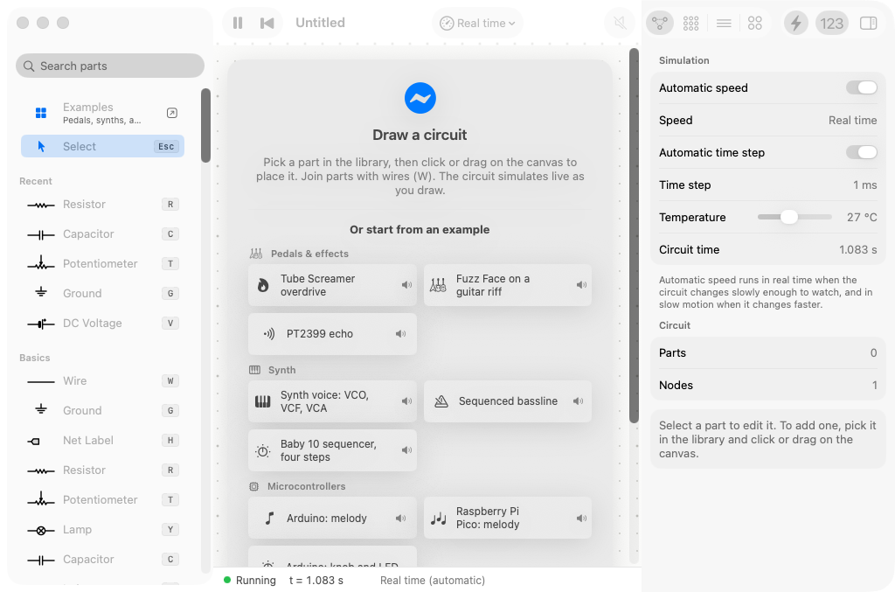
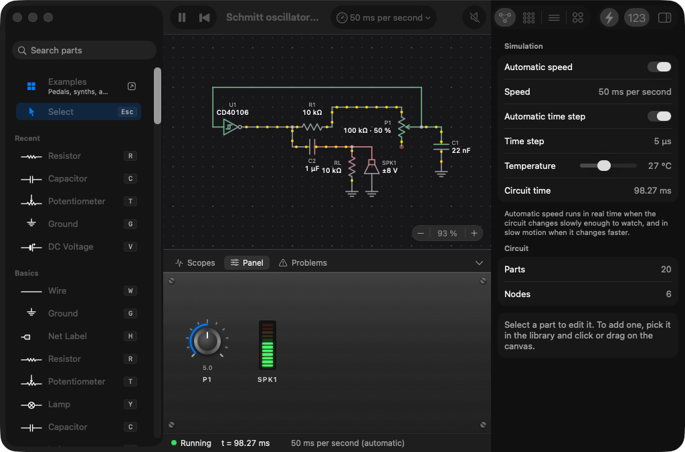
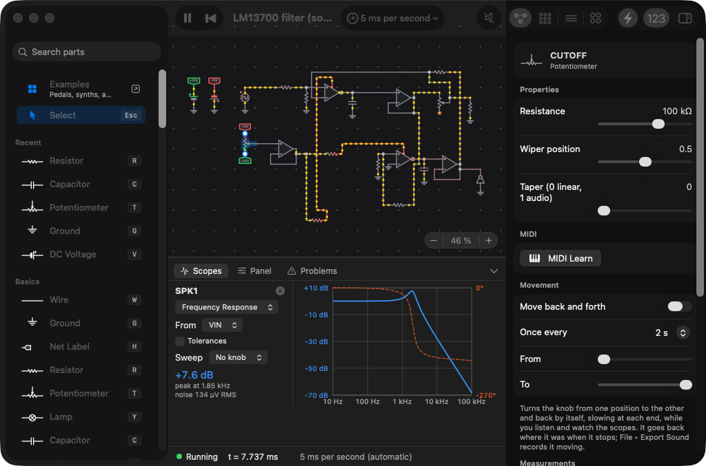
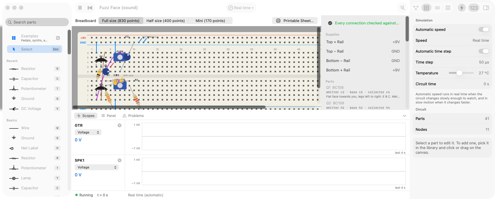

# Using JSpice for Mac

How to draw, run, hear and measure a circuit, build it on a board and keep it in a file. The parts themselves are in [parts.md](parts.md), the examples in [examples.md](examples.md), microcontrollers in [microcontrollers.md](microcontrollers.md) and SPICE import and export in [spice.md](spice.md). Every shortcut is in [shortcuts.md](shortcuts.md).

- [The window](#the-window)
- [Drawing](#drawing)
- [Simulating](#simulating)
- [Sound](#sound)
- [Front panel, MIDI and moving knobs](#front-panel-midi-and-moving-knobs)
- [Scopes and analyses](#scopes-and-analyses)
- [Blocks: circuits as parts](#blocks-circuits-as-parts)
- [Breadboard, stripboard and perfboard](#breadboard-stripboard-and-perfboard)
- [KiCad](#kicad)
- [Audio Unit](#audio-unit)
- [Schematic capture](#schematic-capture)
- [Files, import and export](#files-import-and-export)

## The window

A circuit window has the part library on the left, the canvas in the middle, the inspector on the right and, under the canvas, a dock with up to four tabs:

- **Scopes**: the circuit's scopes, frequency responses and spectra.
- **Panel**: the [front panel](#front-panel-midi-and-moving-knobs) of knobs, switches and buttons.
- **Chip**: a microcontroller's serial monitor, and for an STM32 its bus trace and pins (see [microcontrollers.md](microcontrollers.md)).
- **Problems**: what keeps the circuit from simulating as drawn, and what was left out when its file was read.

A tab is there only when it has something to show. Drag the dock's top edge to resize it, or all the way down to fold it to its tabs.

The toolbar has Run or Pause and Reset, the speed, **Sound**, the view (Schematic, Breadboard, Stripboard or Perfboard), **Current** (the moving dots), **Values** (part names and values) and the inspector. The status bar says whether the circuit is running, its time and how fast it runs.

An empty window shows how to start, with a few examples by interest (pedals and effects, synth, microcontrollers, basics); clicking one opens it in that window. **Browse All Examples…**, the library's **Examples** row, **File ▸ New from Example…** and **Help ▸ Example Gallery** open the Examples window, where every example is filed by category with a drawing of its schematic and can be searched; an example opened from there gets a new window, so nothing open is replaced.

What an operation did (an import, an export, a model downloaded) is told in a toast over the canvas rather than a dialog: successes and notes fade by themselves, warnings and failures stay until dismissed, and a longer account opens in a sheet with **Show Report**, to read and copy.

## Drawing

- **Pick a part and place it.** Pick a part in the library (or press its key: `R` resistor, `C` capacitor, `W` wire, …), then click to place it or drag to set its length and direction. While placing, a ghost of the part follows the pointer and a pill says what you are placing; `Esc` goes back to selecting.
- **Connections.** Parts connect where their ends meet, and a part dropped onto the middle of a wire joins it with a T-junction (wires that merely cross stay apart). Wires stretch when you move the parts they connect. A net label (`H`) connects every label with the same name; `GND` is ground.
- **Keyboard first.** Every part has a shortcut (a letter for the common ones, ⇧ and a letter for the rest; they are shown in the library and in **Help ▸ Keyboard Shortcuts**, ⌘/). ⌘K or / opens a palette: type a part's name, its category or a real part it models ("TL072", "LM13700", "vactrol") and press Return. The palette also finds examples and commands (Tidy Up, Show Front Panel, Open Example Gallery…). Arrow keys nudge the selection (⇧ for five units), ⌘D duplicates it, Tab steps through the parts, and the library can be searched; recently used parts are listed at its top.
- **Rotate and flip.** ⌘R rotates the selection. Transistors, op-amps, OTAs, chips and potentiometers can be flipped as well as rotated (`F` or ⇧⌘R).
- **Tidy Up.** **Circuit ▸ Tidy Up** (⌥⌘T) redraws any circuit, hand-drawn ones included, as a person would draw it, keeping every connection: the signal flows from left to right with the main path on straight lines, sources on the left, parts to ground hanging below the line with ground symbols, pull-ups standing above it, feedback arching over its op-amp, an oscillator's loop returning along the bottom, supply rails as flags (`+12V`, `VCC`), and real wires routed around the parts, with junction dots and few bends or crossings. Circuits an AI agent builds are drawn the same way ([mcp.md](mcp.md)).

## Simulating

- **Live simulation.** The circuit simulates while you draw. Voltages are coloured (green positive, red negative, grey at 0 V), current flows as dots, LEDs and lamps glow, and memristors show their internal state.
- **Real time when possible.** Circuits that change slowly enough to watch run in real time (a capacitor charging over a second, a 1 Hz memristor loop). Faster ones run in slow motion automatically, for example a 100 Hz filter at 5 ms per second, and the status bar says so. If a circuit is too heavy to keep up, it runs as fast as it can and the status bar shows how far behind it is. You can also set the speed yourself, from the speed menu in the toolbar.
- **Interact while it runs.** Click switches, hold push buttons, scroll over a potentiometer to turn it, and drag sliders in the inspector to change values live.
- **Temperature.** With nothing selected, the inspector sets the circuit's temperature (or `set_temperature` for an agent): diodes, LEDs, transistors, JFETs and MOSFETs work at the circuit's temperature, from −40 to 125 °C, their saturation currents scaled as in SPICE (kT/q is 25.865 mV at 27 °C, with ngspice's constants, as a manufacturer's card assumes), so a junction drops about 2 mV less per degree hotter and a bias point drifts as it would on the bench.
- **Run, pause, reset.** Space or ⌘↩ (**Simulation ▸ Run or Pause**) runs and pauses; ⇧⌘↩ (**Simulation ▸ Reset**) restarts from time zero, with capacitors discharged.

## Sound

- **Hear it.** Put a speaker across an output and press **Sound** in the toolbar: the circuit runs in real time, one simulation step per audio sample, on a thread of its own, and you hear it through the Mac's output (with a DC blocker and a soft limit, so a stuck rail is silent and nothing clips harshly). Turn a potentiometer or flip a switch while it plays. The speaker's **full scale** sets the voltage that plays at full volume.
- **Play sound into it.** The **Audio In** source (⇧P) plays a sound into the circuit: a built-in guitar riff, any sound file macOS can read (WAV, AIFF, MP3, AAC…, mixed to mono, up to a minute, kept in the circuit file) chosen in the inspector (**Choose Sound File…**), once or looped, or the Mac's **live input** while sound is on, so a guitar through an audio interface plays the circuit in real time. Its **level** is the voltage of full scale (0.5 V by default, about a guitar's pickup). The **Fuzz Face on a guitar riff** example puts it together.
- **Export the sound.** **File ▸ Export ▸ Sound…** renders the speaker to a 24-bit WAV file offline, as long as you like and however heavy the circuit is, through the same DC blocker and soft limit as the live sound.
- **Play it.** The **Keyboard Pitch** source puts out 1 V per octave (0 V at C2) and the **Keyboard Gate** source a gate while a key is held. With sound on, play them from the Mac's keyboard (A W S E D F T G Y H U J K O L P ; as in GarageBand; Z and X change octave) or from any MIDI keyboard (notes and pitch bend). The newest key sounds, and the pitch stays on the last note after release; give the pitch some **glide** for portamento.
- **Step sequencer.** In the inspector when the circuit has a keyboard source, a step sequencer plays them by itself: up to 32 steps of notes or rests at a sixteenth note each, with tempo and gate length; it keeps time with the circuit, so it is exact with sound on and in automated simulations. The **Keyboard VCO** example is a real 1 V/octave oscillator (a PNP exponential converter and an LM13700 triangle core), and **Mono synth** plays its square wave through an LM13700 VCA opened by an attack–release envelope (the gate charges it through a DG411 switch).

## Front panel, MIDI and moving knobs

- **Front panel.** The **Panel** tab of the dock shows the circuit's potentiometers, switches and push buttons as hardware controls on a faceplate, like a plugin's interface for testing an audio circuit: knobs to drag (double-click to centre), bat toggles to flip, buttons to hold, LEDs as panel lamps, and a level meter for the speaker that turns red when the sound clips. Double-click a label to rename the part. The tab is there whenever the circuit has controls; the palette's **Show Front Panel** opens it too.
- **MIDI Learn.** Right-click a knob, switch or button (on the front panel or the schematic), choose **MIDI Learn** and move a knob, fader or button on a MIDI controller: from then on it turns that knob (across its whole travel) or flips that switch (on from 64 up), knobs inside blocks too. The mapping is saved with the circuit and shown under the control; **Forget** (named for the mapping) takes it away, Esc cancels learning.
- **Knob movement.** A potentiometer's inspector has **Movement**: **Move back and forth** turns the knob from one position to the other and back by itself, once every quarter second to 16 s, slowing at each end as a foot rocks a wah pedal, while you listen and watch the scopes; **From** and **To** set its range. Right-click a knob on the front panel for **Move Back and Forth** too. It goes back where it was when it stops, and **File ▸ Export ▸ Sound…** records it moving. For an agent, `simulate` and `render_audio` take `"knobs": [{"part": "WAH", "period": 2, "low": 0, "high": 1}]` for the same, the knobs moving every millisecond of circuit time.

## Scopes and analyses

Right-click a part (or use **Add to Scope** in its inspector) to add any of these to the dock's Scopes tab.

- **Scopes** for any part's voltage, current, power or resistance over time, or its current against its voltage (**Add I–V Curve Scope**: an I–V curve, such as a memristor's pinched hysteresis loop).
- **Frequency response, live.** Right-click a part and choose **Add Frequency Response** for a Bode plot of its voltage from 10 Hz to 100 kHz: gain in dB and phase, from the circuit's signal source (or any source you pick), with a readout under the pointer and the peak alongside. It is a small-signal analysis like SPICE's `.ac`, made around the circuit's operating point: a copy of the circuit with the driving source held still settles in the background and follows every change. Turn a filter's cutoff or resonance knob and watch the curve move, or turn a fuzz's bias and watch its gain change.
- **Knob sweep.** On a frequency response (or a loop probe's loop gain), choose a knob under **Sweep** to draw the response with that knob at 0, 25, 50, 75 and 100 % as well, coloured from blue to orange under the response as the knob is now: a tone control's whole range, or a gain knob's effect on a loop's phase margin (the legend gives each position's margin), at a glance. Each position is a copy of the circuit settled from rest with the knob there (so a knob that sets a bias moves the operating point too) and linearised in the background; the readout under the pointer gives each position's gain. Knobs inside blocks can be swept too. The `sweep` tool does the same for an agent (`"parameter": "position"` with an `ac` measure).
- **Tolerances.** Tick **Tolerances** on a frequency response to shade where 24 copies of the circuit fall, their resistors drawn within 5 %, capacitors and inductors within 10 % and transistors' gain within 30 % (normally distributed, three standard deviations at the tolerance), each copy settled and linearised in the background. The `sweep` tool steps a value and measures each step; `monte_carlo` measures hundreds of copies (gain and phase, the peak and the corner, an operating point, or a waveform's level and frequency) and gives the spread, with tolerances of your choosing, part by part if need be.
- **Noise.** The frequency response also gives the noise at that output from 20 Hz to 20 kHz (and which part makes most of it), and the `noise` tool gives it frequency by frequency, referred to the input too: every resistor's thermal noise, every junction's shot noise, the channel noise of field-effect transistors, tubes' noise and op-amps' input noise (TL072 18 nV/√Hz, NE5532 5, LM358 40), carried to the output through the linearised circuit, as SPICE's `.noise` does ([how it is computed](how-it-works.md#noise)). It matches ngspice's `.noise` within 0.01 dB.
- **Loop gain and stability.** A **Loop Probe** (in the instruments) breaks a feedback loop where it is placed: its *in* on the side that drives the loop (an op-amp's output), its *out* on the side driven (the feedback network); in the built circuit it is a link, and in a SPICE deck the 0 V source SPICE breaks loops with. Scoped as **Loop Gain** (**Add Loop Gain**), it plots the loop gain T (the return ratio) from 1 Hz to 10 MHz with the phase margin, crossover and gain margin, and the `loop_gain` tool gives the same with every crossing. How T is worked out is in [how-it-works.md](how-it-works.md#loop-gain). The **Op-amp stability** example drives a cable's 100 nF through 100 Ω with its feedback taken from the cable: the probe shows 6° of margin and the square wave rings; with 1 nF of cable the margin is back to 53°.
- **Impedance.** The `impedance` tool gives a node's impedance against frequency (a 1 A test current into it, every source at rest: an amplifier's output impedance, a filter node's), or what a source sees looking into the circuit (its input impedance).
- **Part stress.** The `stress` tool runs the circuit from rest and checks each rated part over the run, as a smoke test: resistors' and lamps' average power against their rated power (a resistor's is ¼ W unless set), capacitors' voltage against their rated voltage (where one is set), diodes and LEDs reversed past their model's breakdown voltage; with the parts that take the most power. The inspector shows a rated part's present share of its rating, orange past half and red past all of it. Nothing is assumed of a part with no rating: a transistor's, a pot's or an op-amp's limits are not checked yet.
- **Spectrum and distortion.** Right-click a part and choose **Add Spectrum**: a spectrum analyser of its voltage (or current), live, with the fundamental, the total harmonic distortion (harmonics 2 to 10) and the RMS level, each harmonic marked on the curve and a readout under the pointer. It analyses the last eight scope windows of the signal, sampled evenly and taken through a Hann window, up to the highest frequency the simulation's steps can show. Turn a fuzz's gain and watch the harmonics climb.

## Blocks: circuits as parts

Give a circuit a **Port** part (in the library's Blocks section) for each of its inputs and outputs and choose **Circuit ▸ Save as Block…** (⇧⌘B). It joins the library's Blocks section, and from there it can be placed in any circuit as one part: a box with the ports as its pins, inputs on the left and outputs on the right (by each port's side, or by where it is drawn). Every copy is a whole circuit of its own, with its own state and its own knobs: they appear in the inspector and on the front panel under the block's name. Blocks can contain blocks. Net labels inside a block stay inside it (only ground is shared), so two copies never join by accident.

Right-click a block and choose **Open Block** to open it as a circuit, change it and save it again, then **Update from Library** its copies. A circuit file keeps its blocks in it, so it opens anywhere. The simulation puts each block's parts in its place, so a block behaves exactly as its parts drawn out would ([how-it-works.md](how-it-works.md#blocks)). A maker's SPICE model imported as a block is described in [spice.md](spice.md#makers-models).

## Breadboard, stripboard and perfboard

Choose a view in the toolbar:

- **Breadboard** shows the circuit built on white solderless breadboards, full size (830 points, 63 columns), half size (400 points, 30 columns) or mini (170 points, 17 columns, no rails, so the supplies go on strips joined by jumpers), as many side by side as it needs (the choice is remembered; their rails are joined, and the bill of materials counts the boards): chips straddling the channel with every pin number from the datasheet (op-amps, gates, inverters and switches packed several to a package, spare units noted), transistors' legs in their real order with the flat face towards you (EBC for a 2N3904, CBE for a BC547C, SGD for a 2N3819), electrolytics' + leg on the higher DC voltage and a voltage rating from the operating point (or the capacitor's own rated voltage), supplies on the rails, jumpers coloured by net, and what is wired from off the board.
- **Stripboard** lays the same circuit out on Veroboard: the supplies on the top and bottom strips, parts standing across the strips, chips straddling a cut with pin 1 top left, the holes where the strips must be cut, the wire links, and pots and switches wired from the panel by their lugs. Its bill of materials adds the board and chip sockets.
- **Perfboard** lays it out on perfboard, a pad round each hole and nothing joining them: the parts stand where the stripboard puts them, and where stripboard would have a piece of strip joining two or more pins, the perfboard has a trail on the copper side, the pads joined along the row by tinned copper wire (drawn silver, seen through the board); no strips to cut, the same wire links on the parts' side. Its bill of materials gives the board's size and the wire's length.

Every layout is checked hole by hole against the schematic's nets (on perfboard, a trail run over another net's pad counts as a short). Hover a hole to see its net; the side panel lists each part's holes and the bill of materials (**Copy CSV**).

Each board view's **Printable Sheet…** (and the `board_sheet` tool) saves the board as an SVG drawing at its true size, holes 2.54 mm apart, with a ruler of ten holes to check the print's scale against: every part in its holes with its name, the strips and cuts, trails, links or jumpers, and under the board the parts with their holes, the bill of materials and the notes. Printed at 100 %, a stripboard's or perfboard's sheet can be laid over the board itself.

## KiCad

**File ▸ Export ▸ KiCad Netlist…** (and the `export_kicad` tool) writes the circuit as a KiCad netlist, to lay out a printed circuit board in KiCad's PCB editor (**File ▸ Import ▸ Netlist** there): the parts as the breadboard has them, op-amps and gates packed into their chips with the supplies the chips need, each on a through-hole footprint from KiCad's own libraries (¼ W axial resistors, ceramic discs, radial electrolytics sized by their capacitance, DO-35 and DO-41 diodes, 5 mm LEDs, TO-92 transistors, DIP chips, 16 mm Alpha pots) with its pads numbered as KiCad numbers them: a transistor's in its pinout's order, a diode's and an LED's cathode on pad 1, an electrolytic's + on pad 1 and the higher DC voltage. Supplies, sources, speakers, switches and the modules wired from off the board each go on a pin header. Parts JSpice knows no footprint for (an inductor, a lamp, a vactrol) are named, for KiCad's footprint assignment; check the electrolytics' and pots' footprints against the parts bought.

## Audio Unit

JSpice.app carries an Audio Unit for Logic, GarageBand, Ableton Live and any other music app: **JSpice: Circuit Effect** runs a circuit with the track's sound in its audio inputs, **JSpice: Circuit Instrument** plays one from MIDI notes on its keyboard sources (the last note held sounds). Its presets are the sound examples and every circuit saved with **File ▸ Export ▸ Audio Unit…** (kept in ~/Music/JSpice/Audio Units); the circuit's knobs and switches are the plugin's parameters, for automation, and the session saves the whole circuit. To check it in a real host, follow [audio-unit-checklist.md](audio-unit-checklist.md).

## Schematic capture

**File ▸ Import ▸ Schematic from Image or PDF…** reads a drawing (a photo or scan, or the first page of a PDF) into a circuit. The page's text labels are found with their places, from the PDF itself or by the Mac's own text recognition, and Claude (claude-opus-5-5, through your Anthropic API key, kept in the login keychain and managed in **JSpice ▸ Settings ▸ API Key**) reads the drawing with them into a netlist of JSpice's parts. JSpice builds it, sends anything that doesn't build (an unknown terminal, an open pin, a net going nowhere) back for another look, and draws the result as a tidy schematic, listing the values it was unsure of and anything it left out. Check it against the drawing before trusting a simulation.

How well it reads is measured on drawings of the examples: CI renders them (`JSpice --render-drawings <folder>`), and `jspice-mcp --capture-eval <folder>` reads each back and scores the parts found, their values and their connections against the example (it runs in CI when the repository has an `ANTHROPIC_API_KEY` secret).

## Files, import and export

JSpice is a Mac document app: one window per circuit, open and save as `.jspice` files, autosave, undo and redo for every edit, copy and paste, light and dark mode.

| Menu | What it does | More |
| --- | --- | --- |
| File ▸ New from Example… | the Examples window | [examples.md](examples.md) |
| File ▸ Import ▸ SPICE Netlist… | a netlist drawn as a schematic | [spice.md](spice.md#importing-a-netlist) |
| File ▸ Import ▸ Schematic from Image or PDF… | a drawing read into a circuit | [above](#schematic-capture) |
| File ▸ Import ▸ Maker's Model… | a maker's model file as a block | [spice.md](spice.md#makers-models) |
| File ▸ Import ▸ Download Maker's Model | a catalogued model straight from its maker | [spice.md](spice.md#downloading-a-makers-model) |
| File ▸ Export ▸ Image… (⇧⌘E) | the schematic as PNG or PDF | |
| File ▸ Export ▸ Sound… | the speaker as a 24-bit WAV file | [above](#sound) |
| File ▸ Export ▸ SPICE Netlist… | a deck for ngspice or LTspice | [spice.md](spice.md#exporting-a-netlist) |
| File ▸ Export ▸ KiCad Netlist… | a netlist for KiCad's PCB editor | [above](#kicad) |
| File ▸ Export ▸ Audio Unit… | an Audio Unit preset | [above](#audio-unit) |

**JSpice ▸ Settings…** (⌘,) has three tabs: **AI Control** ([mcp.md](mcp.md)), **API Key** (for schematic capture) and **Chip Support** (the compilers microcontrollers need, [microcontrollers.md](microcontrollers.md#chip-support)).
