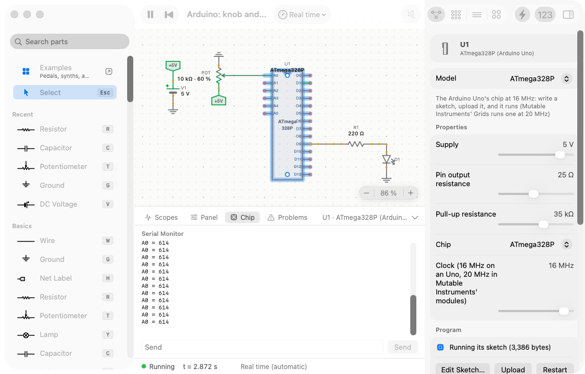

# Microcontrollers

Put a microcontroller in a circuit, write a sketch as in the Arduino IDE (`setup()`, `loop()`, `pinMode`, `digitalWrite`, `analogRead`, `analogWrite`, `delay`, `millis`, `tone`, `Serial`…) and upload it (**Microcontroller ▸ Upload Sketch**, ⌘U; **Microcontroller ▸ Edit Sketch…** opens the editor). The sketch is compiled with the board's real compiler and Arduino core, and the chip runs the firmware instruction by instruction. Its pins drive the circuit through their output resistance and read it with real logic thresholds and optional pull-ups (and pull-downs on the Pico).

The dock's **Chip** tab shows the selected chip's serial monitor (with a field to send it text), and for an STM32 its bus trace and pins; the inspector's **Show Serial Monitor** (or **Show Serial, Bus Trace and Pins**) opens it. The examples come with their firmware built in, so they run without Chip Support. What the chips leave out is listed in [limitations.md](limitations.md#microcontrollers).

- [Building a sketch](#building-a-sketch)
- [AVR: ATmega328P, ATmega2560, ATtiny85](#avr-atmega328p-atmega2560-attiny85)
- [RP2040: Raspberry Pi Pico](#rp2040-raspberry-pi-pico)
- [STM32F405, STM32F373, STM32F103](#stm32f405-stm32f373-stm32f103)
- [Converters and bus parts on the STM32s](#converters-and-bus-parts-on-the-stm32s)
- [Watchdog, bus trace, pins and debugger](#watchdog-bus-trace-pins-and-debugger)
- [What the chips do not run](#what-the-chips-do-not-run)
- [Chip support](#chip-support)
- [Logic parts on a chip's pins](#logic-parts-on-a-chips-pins)

## Building a sketch

**Upload** (in the inspector's Program section or the sketch editor, or ⌘U) compiles the sketch and loads it into the chip, which restarts with it; a chip with no sketch yet is given its board's blink. The build goes in steps, each shown with a progress bar: the Arduino core (compiled once for each board, so only the first build takes long, and says so), the libraries the sketch includes, the sketch, then linking. **Cancel** stops it, and leaves the chip running what it had and nothing half built.

What the compiler says is made plain:

- **Errors and warnings on the sketch's own lines** are listed by line ("Line 12:5: 'ledPin' was not declared in this scope"), errors in red and warnings in orange. The sketch is compiled with its warnings on (`-Wall`); the core's and the libraries' own warnings are left out. A sketch that builds with warnings is still uploaded, and its warnings stay listed. The inspector shows the first four; the sketch editor (**Microcontroller ▸ Edit Sketch…**) shows them all.
- **A problem no line of the sketch explains** is said in one sentence: a function used but never defined, or defined twice; a sketch that does not fit (how many bytes more flash or RAM it needs than the chip has); the core or a library that did not compile (reinstalling it in Chip Support may help). When a build fails, the compiler's whole output opens under **Compiler Output**, to read and copy.
- **Libraries.** A sketch can include the libraries that come with the board's core (EEPROM, SPI, Wire, SoftwareSerial… on the AVR boards; arduino-pico's on the Pico), and the libraries those include in turn. A third-party library (`#include <Adafruit_NeoPixel.h>`) is not there and cannot be added: the build stops with a message that names the header and lists the libraries that are available, and the way round is to paste the code needed into the sketch.

The STM32s compile nothing: the Microcontroller menu's sketch items are disabled for them, and the inspector offers **Load Firmware…** for the HEX file built with their maker's tools. Chip support is never asked of them.

## AVR: ATmega328P, ATmega2560, ATtiny85

**ATmega328P** (the Arduino Uno's chip, pins D0–D13 and A0–A5 as on the board), **ATmega2560** (the Arduino Mega: D0–D53 and A0–A15, six timers, four serial ports) and **ATtiny85** (PB0–PB5, numbered 0–5 in the sketch; 8 MHz, no serial port): one AVR emulator with each chip's layout, at 16 MHz (8 MHz for the ATtiny85): timers and PWM, the ADC, the USARTs (the first is shown in the serial monitor), SPI and two-wire (I²C) as masters (on the Uno and the Mega: `SPI` and `Wire` clock their bits out on the pins at the rates they set, and an I²C address is acknowledged only if something in the circuit pulls SDA low), external and pin-change interrupts and EEPROM. It was checked against simavr instruction for instruction over millions of instructions of real sketches on all three chips.

How it runs fast: each opcode is decoded once, into a table; a timer takes the ticks that only count all at once, and is looked at only at its compare matches, TOP, BOTTOM and overflows (and where the program reads its counter, as `micros()` does), which made the Arduino examples a sixth to a third faster; a busy-wait (a loop polling a flag that an interrupt or a peripheral sets) is counted at once up to the next event, all to the same cycle; and the interpreter runs inside the run's loop rather than being called for every instruction (a tenth faster).

The Uno's part can be set to the **ATmega168** or **ATmega88** (the same pins with less memory; the 88's interrupt vectors a word each), as in Eurorack modules' AVR firmware (Mutable Instruments' Branches, the 4ms Rotating Clock Divider), and to another clock (Mutable Instruments' Grids runs its 328P at 20 MHz): sketches are built for the chip and clock it is set to. **Load Firmware…** (in the Microcontroller menu and the inspector, or `load_firmware`) loads a firmware file built elsewhere, an Intel HEX file or a raw image, as a programmer flashes it.

## RP2040: Raspberry Pi Pico

**RP2040** (the Raspberry Pi Pico: GP0–GP22 and GP26–GP28, 3.3 V, the LED on GP25): a port of [rp2040js](https://github.com/wokwi/rp2040js) running arduino-pico firmware at 125 MHz: the Cortex-M0+ core, timers and alarms, PWM, the ADC, GPIO interrupts, DMA, the hardware divider and interpolators, SPI and I²C controllers as masters (bit by bit on the pins, like the AVR's), and the USB controller, with a simulated computer at the other end of the cable so `Serial` reaches the serial monitor. PIO state machines (behind `tone()` and the I2S library) run in simulated time at their clock dividers, each block visited only once one of its instructions falls due. Checked against rp2040js to the nanosecond on real sketches.

The core runs its instructions in stretches up to the next alarm or PIO instruction, the clock ticked once for each stretch (and brought up to date whenever an instruction reaches a peripheral), to the same nanosecond as ticked after every instruction; with the interpreter inside that loop, the Pico examples run a sixth faster.

## STM32F405, STM32F373, STM32F103

The STM32s run firmware built with its maker's tools, loaded as the HEX file their makefiles leave (**Load Firmware…**; a firmware built to sit behind a bootloader starts from its own vector table). They compile no sketches.

- **STM32F405** (Mutable Instruments' Rings, Clouds, Elements, Warps and Marbles; 49 pins of the 64-pin package, 3.3 V): an ARM Cortex-M4 core with its FPU, in C (`Sources/CortexM4`), checked instruction by instruction against QEMU's Cortex-M4 (fuzzed: Thumb, Thumb-2, the FPU's flags and NaNs, IT blocks) and by a self-test of its interrupts, priorities and FP context; around it the chip's peripherals at their registers (RM0090): the clock tree and PLLs, flash with sector erase and programming (a firmware's saved settings), GPIO, EXTI, both DMA controllers, the ADCs, timers (update and compare events, PWM on their pins), SPI and I²S with the full-duplex extensions, I²C, the USARTs (USART1 on the serial monitor), the DAC and RNG. Its I²S frames go to a **WM8731** codec part wired to its I²S and I²C pins, whose line outputs and inputs sit about half its supply at 1 V RMS full scale. Rings, Clouds, Elements, Warps and Marbles boot and run from Mutable's own firmware; CI builds Rings from Mutable's repository and plays it, strummed, through the codec (`tools/arm-reference`). About 90 million instructions a second where it is developed, where Rings runs at about three quarters of real time.
- **STM32F373** (Plaits, Stages, Tides 2; 53 pins of the 64-pin package, 3.3 V): the same core around the F373's peripherals (RM0313): its clock tree, flash in 2 KB pages, DMA in channels, its 12-bit ADC and its three 16-bit sigma-delta ADCs (injected groups, single-ended or differential, by DMA), SPI and I²S, the USARTs (USART3, Mutable's debug port, on the serial monitor) and timers 2–19. Plaits boots and drones at middle C from Mutable's firmware into a **PCM5100** on its I²S pins, at about three times real time where it is developed; Tides 2 loops into its **DAC8564** and Stages streams its six CVs to its **DAC8568** (the octal CV DAC part: the words these modules send over I²S, a DAC8568 word each frame, a DAC8564 word each PCM word). CI builds Plaits and Tides 2 and checks Plaits' pitch and Tides 2's swing and rate. Its I²C is kept, not run.
- **STM32F103** (Braids, Peaks, Frames, Streams; 35 pins of the 48-pin package, 3.3 V): a Cortex-M3, run as the M4 without its FPU, around the F1's peripherals (RM0008): its GPIO (CRL and CRH) and AFIO, its clock tree, flash in 1 KB pages, DMA1, two ADCs, timers 1–4, SPI, I²C and USARTs (USART1 on the serial monitor). Their DACs on SPI are the CV DAC part (a word after each fall of its SYNC, on any of the chip's pins), and an MCP3204 or MCP3008 on an SPI port answers the chip frame by frame. Braids plays its first shape into its DAC8551 at 96 kHz, reading its CVs from its MCP3204 (CI builds it and checks its pitch); Peaks, Frames and Streams run their DACs at 48, 32 and 31 kHz a channel.

## Converters and bus parts on the STM32s

On all three STM32s, a converter (codec, DAC, ADC) is reached only as the firmware has set the chip up, as on a board: each of its terminals must be on a pin carrying the matching signal of one port, by the pin's alternate function (or the F103's remaps, from ST's own pin data: `tools/arm-reference/pinmap.py`), and the port must run in a mode the part takes:

- an SPI DAC's data changing on SCLK's rising edge, an ADC's on its falling one, MSB first, the chip the master;
- a PCM5102 sent I²S or left-justified frames;
- a codec given its MCLK;
- its control port answering at its own I²C address: a WM8731 at 0x1A, a CS4270 at 0x48 and its AD pins, a PCM3060 at 0x46, an AK4558 at 0x10, the AK4556 set up by its pins with none.

When the chip's frames flow and a part wired to it is not reached, the circuit's problems (the dock's Problems tab) say which terminal is on which pin, what the firmware has that pin carry, and what it would need, and the part gets nothing: a board wired or programmed wrong does not seem to work.

An SPI port as a master drives its SCK (at its idle level) and MOSI, and puts each frame on them edge by edge, in its mode, so that the parts that take their bits from the pins (a 74HC595, an MCP4921 or MCP4822) take them from the chip's SPI as they do from its GPIO writes, the clock and its edge checked as above (MCP3x0x ADCs work bit-banged too). Bus parts:

- A **74HC165** (the parallel-in shift register that reads a panel's buttons and switches) shifts its inputs onto the port's MISO, which the port reads just before each sampling edge, so a firmware reading it in the wrong SPI mode misses D7 as on the board.
- An MCP4725 answers on one of the chip's I²C ports (a transaction at a time, from the port's registers, not from SCL and SDA bit by bit), as does a **PCA9685** (sixteen 12-bit PWM outputs for a panel's LEDs: its registers written and read through the chip's I²C or bit by bit from GPIO writes, its outputs switching at its prescaler's rate between their ON and OFF counts, asleep from reset as the chip is).
- A **TLC5947** (twenty-four 12-bit PWM constant-current LED sinks) takes its 288 bits from an SPI port or GPIO writes as a 74HC595 does, latched by XLAT, each output sinking 41 × 1.2 V over its IREF resistor for its grayscale count of each 976 Hz cycle, falling off below its knee, so an LED's current comes out as on the board, and what is left of its supply shows.
- A **24LC-series EEPROM** (24LC02B to 24LC512: a firmware's saved settings) answers on an I²C port at 0x50 + A2–A0: page writes wrap round within their page as on the chip, are written only at the STOP, and take their 5 ms write cycle, the chip answering nothing until it ends (a firmware that does not wait or poll for the acknowledge loses its next write); WP high protects it, and what it holds can be read from the simulator.

What the firmware reaches that the model does not run is said too (a peripheral it leaves out, such as CAN, USB or SDIO; one whose registers it keeps without running them, such as the F373's I²C; an address where the chip has nothing), with where in the firmware it first did.

## Watchdog, bus trace, pins and debugger

- **Watchdog.** The independent watchdog runs on all three: a firmware that stops reloading it is reset when it runs out, as is one that asks for a reset (SYSRESETREQ), its RAM kept and RCC_CSR saying why, and the circuit's problems say how often.
- **Bus Trace** (in the dock's Chip tab) shows what goes over the chip's buses as a logic analyzer would decode it (each SPI and I²S frame, I²C address, byte and stop with its acknowledge, USART byte, with its time). Agents read it with `read_bus_trace`.
- **Pins** (in the Chip tab too) shows what each pin carries as the firmware has set it up. Agents read it with `read_chip_state`.
- **Debugger** (in the inspector: **Start GDB Server**) starts a GDB server for the chip, as a debug probe's server: `arm-none-eabi-gdb firmware.elf -ex "target extended-remote localhost:3333"` (or an IDE's debugger) then sets breakpoints, steps, reads and writes registers (the FPU's too) and memory, loads firmware into flash and resets the chip (`monitor reset`), while the firmware runs in the circuit. Halted, the core runs no instructions, but the chip's clock and peripherals run on with the circuit, as on a chip whose debug freeze bits are clear. Agents start it with `gdb_server`.

## What the chips do not run

A sketch that does something a chip's model does not run gets a problem on the chip's part (the dock's Problems tab), once, saying what it did and what happens here instead, with where in the firmware it first did; a reset or new firmware clears it.

- **AVR:** sleeping (SLEEP with sleep enabled: the chip runs straight on); the watchdog turned on (it never resets the chip, and the problem says when it would have), or its interrupt; writing its own flash (SPM); the analog comparator set up; SPI or I²C set up as a slave; the clock divided (CLKPR); peripherals powered down (PRR, a note); Timer2 on a watch crystal (ASSR); the Mega's external memory; the ATtiny85's USI, and Timer1 on its PLL.
- **Pico:** starting the second core (`setup1()` and `loop1()`: an error, as core 1's code never runs and core 0 stops waiting for it); writing to flash (`EEPROM.commit()`, LittleFS); the watchdog turned on or run out, and a reboot asked for (none restarts the chip); the BOOTSEL button read; a block the model leaves out (the ring oscillator, the voltage regulator), each once, and an address where the chip has nothing.
- **STM32:** see [Converters and bus parts](#converters-and-bus-parts-on-the-stm32s) and [Watchdog](#watchdog-bus-trace-pins-and-debugger).

## Chip support

**Microcontroller ▸ Chip Support…** (and **JSpice ▸ Settings ▸ Chip Support**, which shows what is installed) installs the compiler and the core the first time, downloaded over HTTPS and checked against the SHA-256 checksums of the makers' package indexes into JSpice's Application Support folder; nothing else to install, and an archive whose checksum is not a SHA-256 or does not match is not installed. For the AVR chips, avr-gcc and the Arduino AVR core from Arduino's package index (about 40 MB); for the Pico, arm-none-eabi-gcc and Earle Philhower's [arduino-pico](https://github.com/earlephilhower/arduino-pico) 6.2.0 from its package index (about 240 MB). An Arduino IDE already on the Mac is used too. STM32 chips run firmware built elsewhere, and need none. Agents install it with `install_chip_support`.

An install shows its progress and can be cancelled. It goes on in the background when the sheet or the Settings window is closed, the same install shown wherever Chip Support is open (and in the inspector and the sketch editor, which can cancel it too; the sketch editor can start one itself); a failed one says why and offers **Try Again**, and an installed family can be removed. Uploading a sketch before its chip support is there opens Chip Support, or, while it is still installing, says to upload again once it is done.

## Logic parts on a chip's pins

Logic parts wired straight to a chip's pins see everything the chip does on them, however fast. The chip logs those pins' changes as it runs: the AVR after each instruction and at each SPI and two-wire event within one, the Pico as its GPIOs change. The simulator plays them into the logic parts in order. An SPI word clocked out at 8 MHz, sixteen bits within one step of the circuit, reaches an MCP4921 DAC bit by bit.
